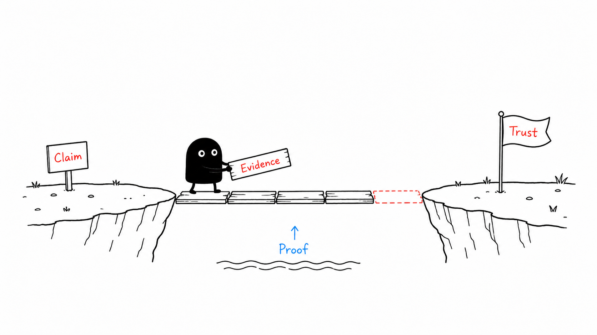
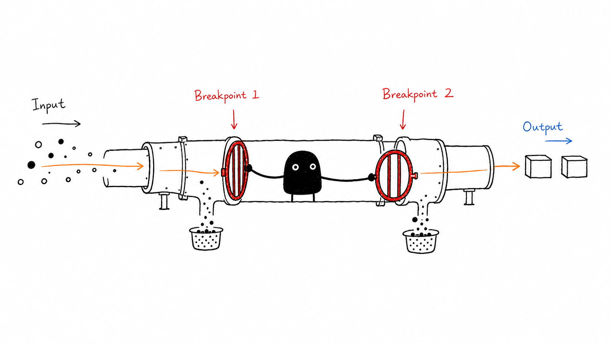
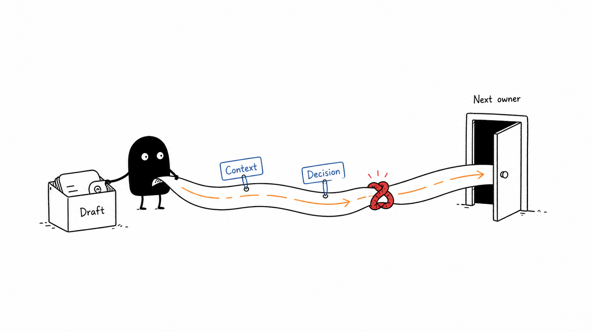

<p align="center">
  
</p>

# InkExplain

[](LICENSE)
[](https://github.com/agustinpabon/InkExplain/actions/workflows/ci.yml)
[](SECURITY.md)
[](package.json)

*Ideas made visual.*

Turn complex ideas into beautiful, consistent hand-drawn illustrations with AI.

<!-- inkexplain:languages:start -->
**English** | [Español](./readmes/README.es.md) | [Português](./readmes/README.pt.md) | [Deutsch](./readmes/README.de.md) | [Français](./readmes/README.fr.md) | [简体中文](./readmes/README.zh.md) | [繁體中文](./readmes/README.zh-Hant.md) | [한국어](./readmes/README.ko.md) | [日本語](./readmes/README.ja.md) | [العربية](./readmes/README.ar.md) | [Русский](./readmes/README.ru.md) | [Türkçe](./readmes/README.tr.md) | [Українська](./readmes/README.uk.md)
<!-- inkexplain:languages:end -->

InkExplain is a skill for AI agents. Give it an article, a document, a piece of code, or a single idea. It finds the ideas worth drawing, turns each one into a physical action that a character performs, and writes a prompt for every image so that the whole series stays consistent. If your agent has an image tool, it also generates, reviews, and saves the images.

|  |  |  |
|---|---|---|
| **One fish, many uses** | **Trust bridge** | **Two breakpoints** |

*Sample renders of Xiaohei, shown unmodified with their credits ([where each came from](docs/provenance.md)). Samples of the other characters, and of InkExplain's own styles, Sketch and Stickman, are published only after review.*

## Install

```bash
npx skills add agustinpabon/InkExplain --skill inkexplain
```

This uses the open [skills CLI](https://skills.sh) (Node.js 22.20 or newer). It detects your agent, such as Claude Code, Codex, Cursor, Gemini CLI, GitHub Copilot, OpenCode, or Windsurf, and copies the skill into the folder that agent reads. Add `-g` to install it for all your projects, or `-a <agent>` to choose the agent. By default the CLI sends anonymous usage telemetry; set `DISABLE_TELEMETRY=1` to turn it off. InkExplain itself collects nothing.

Without Node.js, copy the folder `skills/inkexplain/` into your agent's skills folder yourself; [Supported environments](#supported-environments) lists them.

## Use

Ask for InkExplain by name, or describe the task and let your agent pick the skill up. In Claude Code run `/inkexplain`; in Codex use `$inkexplain`.

```text
/inkexplain Illustrate this article with four images in the Littlebox style and save them in the project.

<paste the article>
```

More prompts, for every character, mixed requests, prompt-only runs, and repairs, are in [examples/prompts.md](examples/prompts.md).

Without an image tool (Claude Code has none built in), InkExplain switches to **prompt mode**: a shot list and one ready-to-paste prompt per image, saved as `prompts.md` in your project. It never claims to have generated an image it did not.

## Supported environments

| Agent | Skill folder in a project |
|---|---|
| Claude Code | `.claude/skills/inkexplain` |
| Codex | `.agents/skills/inkexplain` |
| Cursor | `.agents/skills/inkexplain`; Cursor also reads `.claude/skills/` and `.codex/skills/` |
| Gemini CLI, GitHub Copilot, OpenCode | `.agents/skills/inkexplain` |
| Windsurf | `.windsurf/skills/inkexplain` |
| Other agents that read `SKILL.md` packages | their skills folder |

With `-g`, the CLI installs into the agent's personal folder instead (for example `~/.claude/skills/` for Claude Code and `~/.agents/skills/` for Codex).

What has been tested: the skills CLI places the skill correctly for each agent above, and Claude Code lists it. Fresh Claude Code agent sessions pointed at the installed skill followed it correctly on 15 requests, with no image tool, in prompt mode ([evaluation](docs/evaluation.md)). Not tested: whether a host picks the skill up from a plain request, running it inside Codex, Cursor, Gemini CLI, GitHub Copilot, OpenCode, or Windsurf, and image generation with any image tool.

## What it does

1. **Choose a character.** An archetype fixes who performs the idea, how they move, and how the scene is drawn. With no request, InkExplain uses its own brand-neutral style, InkExplain Sketch.
2. **Extract the concept.** The core thesis and the cognitive anchors: breakpoints, handoffs, trade-offs, loops, before-and-after changes.
3. **Plan.** One image per idea, each with a structure type, a place on the composition grid, and an everyday metaphor that the character performs.
4. **Write the prompts** from the archetype's own template, in a fixed order, and generate one image per tool call when your agent can.
5. **Review and repair** every image against a shared checklist and the archetype's own: stray titles, misspelled labels, crowded scenes, off-model characters.
6. **Save and report** to `assets/<article-slug>-…/` in your workspace, with a short delivery report.

It suits technical articles, product and architecture explanations, workflows, comparisons, course material, and code. [docs/walkthroughs.md](docs/walkthroughs.md) follows four examples from a snippet to the finished prompt: a Rust deadlock drawn by Ferris, a Go channel by the Go Gopher, an async Python loop by Littlebox, and a binary search by Stickman. Modes, output conventions, and the command-line prompt helper are in [docs/usage.md](docs/usage.md).

## Characters

An archetype fixes who performs the idea, how they move, and how the scene is drawn. InkExplain Sketch is the default; every other archetype is chosen by name. Archetypes never mix inside one image.

<!-- inkexplain:archetypes:start -->
| Archetype | Category | Style summary | Legal status |
|---|---|---|---|
| InkExplain Sketch (`ink`, default) | `house-style` | InkExplain's own brand-neutral style: black ink line art, one explainer-blue flow accent, a single highlighter-yellow emphasis, and a neutral ink figure or hands that perform the idea. | `active` · MIT · InkExplain contributors |
| Stickman (`stickman`) | `house-style` | InkExplain's own recurring stick figure: a bold black marker line, a round head with two dot eyes, and bendy limbs that act out the idea on a pure white page, with at most one vermilion accent. | `experimental` · MIT · InkExplain contributors |
| Xiaohei (`xiaohei`) | `mascot` | Ian's Xiaohei, a small solid-black creature with white dot eyes and thin legs, doing serious, slightly absurd work inside sparse black-ink sketches on a pure white page. | `active` · MIT · Ian |
| Littlebox (`littlebox`) | `tribute-character` | A closed paper-box character in thick rough marker on a pure white page that turns ideas into collecting, packaging, sorting, and delivering. | `active` · MIT · okooo5km |
| Ferris (`ferris`) | `mascot` | Ferris the Rustacean, the Rust community crab, performing the idea in sparse hand-drawn article sketches without Rust logos or endorsement cues. | `active` · CC0 public-domain dedication · Karen Rustad Tolva |
| OpenClaw (`openclaw`) | `mascot` | The OpenClaw mascot, a red round character with claw-like arms, two antennae, and cyan pupils, performing the idea in sparse hand-drawn article sketches. | `active` · MIT · OpenClaw Foundation |
| Go Gopher (`gopher`) | `mascot` | The Go gopher designed by Renee French performing the idea in sparse hand-drawn article sketches, credited and free of Go logos or endorsement claims. | `active` · CC BY 4.0 (the design); CC BY 3.0 (the bundled reference drawing) · Renee French |
| Tux (`tux`) | `mascot` | Tux, the Linux penguin created by Larry Ewing, performing the idea in sparse article sketches without distro logos, product graphics, or endorsement claims. | `active` · Free to use and modify with credit to Larry Ewing and The GIMP · Larry Ewing |
<!-- inkexplain:archetypes:end -->

`active` archetypes are ready to use. `experimental` ones are selected only by name and flagged in every delivery. Aliases, motion rules, style sheets, credits, and restrictions for each are in [routing.md](skills/inkexplain/references/routing.md), generated from the registry [registry.json](skills/inkexplain/registry.json). Littlebox draws on a pure white page unless you ask for warm off-white, pale sky blue, pale lavender, or a light color of your own.

## Example gallery

Sample renders of Xiaohei, shown unmodified. Samples of the other characters are published only after they have been reviewed.

| Sort by purpose | Handoff path | Idea press |
|---|---|---|
|  |  |  |

<!-- inkexplain:gallery-credits:start -->
Xiaohei is Ian's character from Ian Xiaohei Illustrations (MIT). The English-labeled renders are copies of images published by Visual IP Illustrations (MIT), and the Chinese-labeled renders are copies of Ian's own images; all are unmodified and in [examples/gallery](examples/gallery) ([where each came from](docs/provenance.md)). Samples of the other characters are withheld until they are reviewed.
<!-- inkexplain:gallery-credits:end -->

Open the [interactive gallery](examples/gallery/index.html) in a browser to see every archetype with its motion rules, style, rights, and approved renders, to filter by category and technique, and to assemble a prompt for your own idea with one-click copy. It is a single file that works from a checkout with no server and no network.

Stickman is InkExplain's own character. Its reference sheet below is hand-built vector art, not an AI render; no render of Stickman has been reviewed yet.

<p align="center">
  
</p>

## Adding New Characters and Animation Styles

```bash
npm run archetype:add -- --id example-fox --name "Example Fox"
```

One command writes the registry entry, the five-file pack, a credit, an example prompt, and the regenerated documents. It checks the whole result before it writes anything and only adds: it never replaces an existing archetype or pack. The new archetype starts `experimental`, and whatever it cannot know, such as who holds the rights, is marked `UNRESOLVED` or `TODO` instead of being guessed; the checks refuse to promote a pack while a marker remains. The full walkthrough, with the rights questions to answer first, is in [docs/adding-an-archetype.md](docs/adding-an-archetype.md).

## Limitations

- InkExplain ships no image model; image quality depends on the tool your agent uses, and no image tool was available while this release was prepared.
- Image models misspell labels, non-Latin scripts most of all. Keep labels short and review them.
- InkExplain Sketch has no reviewed sample renders, and Stickman is `experimental`: its pack and reference sheet are complete, but no render has been reviewed, so each delivery says so. The gallery images are copies from the projects InkExplain builds on; none was generated for this project.
- Third-party archetypes carry their owners' terms, and not every right is settled: [docs/provenance.md](docs/provenance.md) lists what is still open, and the Seal character, which was withdrawn because its rights could not be confirmed.
- The README translations were produced with AI assistance, have not been reviewed by professional translators, and follow an earlier layout of this page, so they may lag behind it. Generated tables keep registry data in English.

## Documentation

| | |
|---|---|
| [Using InkExplain](docs/usage.md) | modes, output conventions, command-line prompt helper, customizing |
| [Code walkthroughs](docs/walkthroughs.md) | four snippets taken to a finished prompt |
| [Adding a character](docs/adding-an-archetype.md) | rights first, the scaffold, promotion, publishing samples |
| [Evaluation](docs/evaluation.md) | the requests run against the skill, what they found, and what is still untested |
| [Reviewing real renders](docs/visual-review.md) | the protocol for the review no one has done yet: three ideas, the checks, the continuity test, and a form for the result |
| [Characters to add next](docs/future-archetypes.md) | which candidates look safe to build, and which to leave out |
| [Visual system](docs/visual-system.md) | what makes each style recognizable |
| [Architecture](docs/architecture.md) | progressive disclosure, the registry, the checks |
| [Provenance and rights record](docs/provenance.md) | where everything came from and what is still open |
| [Security](SECURITY.md) | what the skill does and does not do, and how to report a problem |
| [Contributing](CONTRIBUTING.md), [AGENTS.md](AGENTS.md) | development workflow; `npm run check` runs everything CI runs |

## Credits and license

<!-- inkexplain:credits:start -->
InkExplain builds on three earlier MIT-licensed projects: [Visual IP Illustrations](https://github.com/yangchuansheng/visual-ip-illustrations) by yangchuansheng, [Ian Xiaohei Illustrations](https://github.com/helloianneo/ian-xiaohei-illustrations) by Ian, and [5km Littlebox Illustrations](https://github.com/okooo5km/5km-littlebox-illustrations) by okooo5km. Its gallery images are unmodified copies from the first two. Third-party characters and marks remain the property of their respective owners. See [ATTRIBUTIONS.md](ATTRIBUTIONS.md) for the origins, individual character notices, and licenses.
<!-- inkexplain:credits:end -->

InkExplain is released under the [MIT License](LICENSE).
