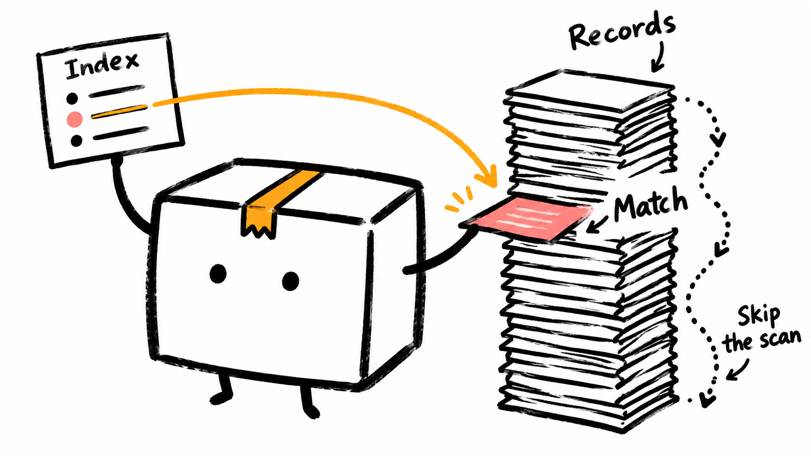
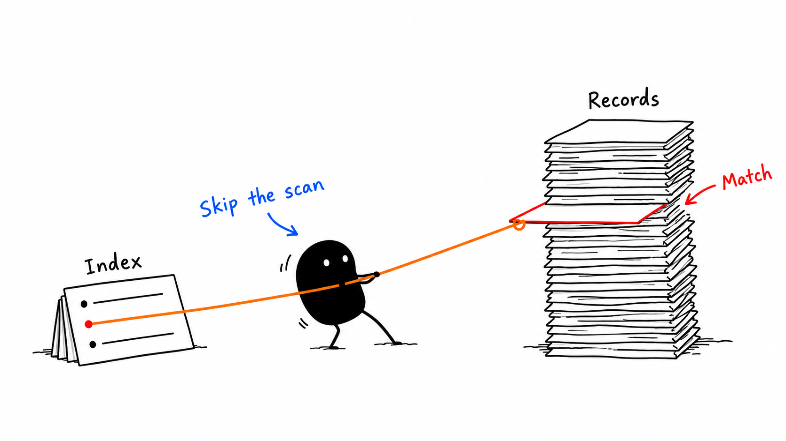

# InkExplain

*Ideas made visual.*

Turn complex ideas into beautiful, consistent hand-drawn illustrations with AI.

InkExplain is a skill for AI agents. Give it an article, a document, some code, or one idea, and it plans the illustrations, writes a prompt for each one, and keeps the whole series in one style. It uses the image tool your agent already has: no API key, no extra account.

[](LICENSE)
[](https://github.com/agustinpabon/InkExplain/actions/workflows/ci.yml)
[](SECURITY.md)

<!-- inkexplain:languages:start -->
**English** | [Español](./readmes/README.es.md) | [Português](./readmes/README.pt.md) | [Deutsch](./readmes/README.de.md) | [Français](./readmes/README.fr.md) | [简体中文](./readmes/README.zh.md) | [繁體中文](./readmes/README.zh-Hant.md) | [한국어](./readmes/README.ko.md) | [日本語](./readmes/README.ja.md) | [العربية](./readmes/README.ar.md) | [Русский](./readmes/README.ru.md) | [Türkçe](./readmes/README.tr.md) | [Українська](./readmes/README.uk.md)
<!-- inkexplain:languages:end -->

|  |  |
|---|---|
| **Littlebox** explains a database index | **Xiaohei** explains the same idea |

*Both made from the request "Illustrate how database indexing makes queries faster", with InkExplain and Codex Desktop's built-in image tool, one image each, on 2026-10-17. They are first tries, not scored with the [review protocol](docs/visual-review.md). Both characters are by others and credited in [ATTRIBUTIONS.md](ATTRIBUTIONS.md).*

## Install

```bash
npx skills add agustinpabon/InkExplain --skill inkexplain
```

This uses the open [skills CLI](https://skills.sh) (Node.js 22.20 or newer) to copy the skill into the folder your agent reads. Add `-g` to install it for all your projects, or `-a <agent>` to choose the agent. The CLI sends anonymous install counts unless you set `DISABLE_TELEMETRY=1`; InkExplain itself collects nothing. Without Node.js, copy the folder `skills/inkexplain/` into your agent's skills folder yourself ([the folders](#supported-environments)).

## Use

Ask in plain words:

```text
Use InkExplain with Littlebox.

Illustrate how database indexing makes queries faster.

Generate 3 consistent illustrations.
```

You get a shot list and three illustrations in one style, saved with their prompts in `assets/<slug>-littlebox/`, or the three prompts alone when your agent cannot draw. In Claude Code you can also type `/inkexplain`, and in Codex start with `$inkexplain`. If your agent has an image skill of its own, name InkExplain in the request, as above, so that the request reaches it. More prompts, for every character, mixed requests, prompt-only runs, and repairs, are in [examples/prompts.md](examples/prompts.md).

Installing the skill does not install an image generator. It needs no API key of its own: it calls the image tool your agent already has, one image per call, and saves each image in your project. That is Codex's built-in `image_gen` (through its `$imagegen` skill), the Agent's `GenerateImage` in Cursor, or an image tool you connected yourself. The maintainer confirmed real generation in Codex Desktop (the two images above); [which host can generate](docs/usage.md#image-generation-by-host) lists the rest. Without a callable image tool (Claude Code and Gemini CLI have none built in), it switches to **prompt mode**: the shot list and one ready-to-paste prompt per image, saved as `prompts.md`, and a plain statement that nothing was generated.

## Supported environments

The skills CLI places the skill in these folders. The last column is what has been seen, not what should work.

| Agent | Skill folder in a project | Generates images? |
|---|---|---|
| Codex Desktop | `.agents/skills/inkexplain` | **Yes, confirmed:** built-in `image_gen`, no API key (Littlebox and Xiaohei above) |
| Codex CLI | `.agents/skills/inkexplain` | The skill runs and writes prompts; `codex exec` here exposed no `image_gen`, so generation was not seen there |
| Cursor | `.agents/skills/inkexplain` (also reads `.claude/skills/`) | Has an Agent `GenerateImage` tool (Cursor 2.4+); **not tested** |
| Claude Code | `.claude/skills/inkexplain` | **No built-in generator.** Prompts, or connect an image tool (MCP) you already use |
| Gemini CLI | `.agents/skills/inkexplain` | **No built-in generator.** Prompts, or add an image extension, which needs its own API key |
| GitHub Copilot, OpenCode, Windsurf, others | their skills folder | Placed by the CLI; not run |

"Not tested" means exactly that. Without a callable image tool InkExplain gives you the shot list and ready-to-paste prompts and says nothing was generated; it never draws the image itself and never switches to a paid API on its own.
With `-g`, the CLI installs into the agent's personal folder instead (for example `~/.claude/skills/` for Claude Code and `~/.agents/skills/` for Codex). [docs/evaluation.md](docs/evaluation.md) says what each run found and what it cannot show.

## What it does

1. **Choose a character.** An archetype fixes who performs the idea, how they move, and how the scene is drawn. With no request, InkExplain uses its own brand-neutral style, InkExplain Sketch.
2. **Extract the concept.** The core thesis and the cognitive anchors: breakpoints, handoffs, trade-offs, loops, before-and-after changes.
3. **Plan.** One image per idea, each with a structure type, a place on the composition grid, and an everyday metaphor that the character performs.
4. **Write the prompts** from the archetype's own template, in a fixed order, and generate one image per tool call when your agent can.
5. **Review and repair** every image against a shared checklist and the archetype's own: stray titles, misspelled labels, crowded scenes, off-model characters.
6. **Save and report** to `assets/<article-slug>-…/` in your workspace, with a short delivery report.

<p align="center">
  
</p>

It suits technical articles, product and architecture explanations, workflows, comparisons, course material, and code. [docs/walkthroughs.md](docs/walkthroughs.md) follows four examples from a snippet to the finished prompt: a Rust deadlock drawn by Ferris, a Go channel by the Go Gopher, an async Python loop by Littlebox, and a binary search by Stickman. Modes, output conventions, and the command-line prompt helper are in [docs/usage.md](docs/usage.md).

## Characters

An archetype fixes who performs the idea, how they move, and how the scene is drawn. InkExplain Sketch is the default; every other archetype is chosen by name. Archetypes never mix inside one image.

<!-- inkexplain:archetypes:start -->
| Archetype | Category | Style summary | Legal status |
|---|---|---|---|
| InkExplain Sketch (`ink`, default) | `house-style` | InkExplain's own brand-neutral style: black ink line art, one explainer-blue flow accent, a single highlighter-yellow emphasis, and a neutral ink figure or hands that perform the idea. | `active` · MIT · InkExplain contributors |
| Littlebox (`littlebox`) | `tribute-character` | A closed paper-box character in thick rough marker on a pure white page that turns ideas into collecting, packaging, sorting, and delivering. | `active` · MIT · okooo5km |
| Stickman (`stickman`) | `house-style` | InkExplain's own recurring stick figure: a bold black marker line, a round head with two dot eyes, and bendy limbs that act out the idea on a pure white page, with at most one vermilion accent. | `experimental` · MIT · InkExplain contributors |
| Xiaohei (`xiaohei`) | `mascot` | Ian's Xiaohei, a small solid-black creature with white dot eyes and thin legs, doing serious, slightly absurd work inside sparse black-ink sketches on a pure white page. | `active` · MIT · Ian |
| Ferris (`ferris`) | `mascot` | Ferris the Rustacean, the Rust community crab, performing the idea in sparse hand-drawn article sketches without Rust logos or endorsement cues. | `active` · CC0 public-domain dedication · Karen Rustad Tölva |
| OpenClaw (`openclaw`) | `mascot` | The OpenClaw mascot, a red round character with claw-like arms, two antennae, and cyan pupils, performing the idea in sparse hand-drawn article sketches. | `active` · MIT · OpenClaw Foundation |
| Go Gopher (`gopher`) | `mascot` | The Go gopher designed by Renee French performing the idea in sparse hand-drawn article sketches, credited and free of Go logos or endorsement claims. | `active` · CC BY 4.0 (the design); CC BY 3.0 (the bundled reference drawing) · Renee French (design); Takuya Ueda (bundled drawing) |
| Tux (`tux`) | `mascot` | Tux, the Linux penguin created by Larry Ewing, performing the idea in sparse article sketches without distro logos, product graphics, or endorsement claims. | `active` · Free to use and modify with credit to Larry Ewing and The GIMP · Larry Ewing |
<!-- inkexplain:archetypes:end -->

`active` archetypes are ready to use. `experimental` ones are selected only by name and flagged in every delivery. Aliases, motion rules, style sheets, credits, and restrictions for each are in [routing.md](skills/inkexplain/references/routing.md), generated from the registry [registry.json](skills/inkexplain/registry.json). Littlebox draws on a pure white page unless you ask for warm off-white, pale sky blue, pale lavender, or a light color of your own.

## Example gallery

Sample renders of Xiaohei, shown unmodified. The other characters have no published samples yet.

| Sort by purpose | Handoff path | Idea press |
|---|---|---|
|  |  |  |

<!-- inkexplain:gallery-credits:start -->
Xiaohei is Ian's character from Ian Xiaohei Illustrations (MIT). The English-labeled renders are copies of images published by Visual IP Illustrations (MIT), and the Chinese-labeled renders are copies of Ian's own images; all are unmodified and in [examples/gallery](examples/gallery) ([where each came from](docs/provenance.md)). Samples of the other characters are withheld until they are reviewed.
<!-- inkexplain:gallery-credits:end -->

Open the [interactive gallery](examples/gallery/index.html) in a browser to see every archetype with its motion rules, style, rights, and approved renders, to filter by category and technique, and to assemble a prompt for your own idea with one-click copy. It is a single file that works from a checkout with no server and no network.

Stickman is InkExplain's own character. Its reference sheet below is hand-built vector art, not an AI render; no render of Stickman exists yet.

<p align="center">
  
</p>

## Adding New Characters and Animation Styles

```bash
npm run archetype:add -- --id example-fox --name "Example Fox"
```

One command writes the registry entry, the five-file pack, a credit, an example prompt, and the regenerated documents. It checks the whole result before it writes anything and only adds: it never replaces an existing archetype or pack. The new archetype starts `experimental`, and whatever it cannot know, such as who holds the rights, is marked `UNRESOLVED` or `TODO` instead of being guessed; the checks refuse to promote a pack while a marker remains. The full walkthrough, with the rights questions to answer first, is in [docs/adding-an-archetype.md](docs/adding-an-archetype.md).

## Limitations

- InkExplain ships no image model. Image quality depends on the tool your agent uses, and real renders exist only for Littlebox and Xiaohei (one image each, from Codex Desktop, not yet scored with the review protocol). None exists for InkExplain Sketch or Stickman.
- Image models misspell labels, non-Latin scripts most of all. Keep labels short and review them.
- Stickman is `experimental`: its pack and reference sheet are complete, but no render has been reviewed, so each delivery says so. The gallery images are copies from the projects InkExplain builds on; none was generated for this project.
- Some agents send a generic image request ("create four illustrations") to an image skill of their own. Name InkExplain in the request to be sure.
- Third-party archetypes carry their owners' terms, and not every right is settled: [docs/provenance.md](docs/provenance.md) lists what is still open.
- The README translations were produced with AI assistance, have not been reviewed by professional translators, and follow an earlier layout of this page, so they may lag behind it. Generated tables keep registry data in English.

## Documentation

| | |
|---|---|
| [Using InkExplain](docs/usage.md) | modes, output conventions, command-line prompt helper, customizing |
| [Code walkthroughs](docs/walkthroughs.md) | four snippets taken to a finished prompt |
| [Adding a character](docs/adding-an-archetype.md) | rights first, the scaffold, promotion, publishing samples |
| [Evaluation](docs/evaluation.md) | the requests run against the skill, what they found, and what is still untested |
| [Reviewing real renders](docs/visual-review.md) | the protocol for the review no one has done yet: three ideas, the checks, the continuity test, and a form for the result |
| [Characters to add next](docs/future-archetypes.md) | which candidates look safe to build, and which to leave out |
| [Visual system](docs/visual-system.md) | what makes each style recognizable |
| [Architecture](docs/architecture.md) | progressive disclosure, the registry, the checks |
| [Provenance and rights record](docs/provenance.md) | where everything came from and what is still open |
| [Security](SECURITY.md) | what the skill does and does not do, and how to report a problem |
| [Contributing](CONTRIBUTING.md), [AGENTS.md](AGENTS.md) | development workflow; `npm run check` runs everything CI runs |

## Credits and license

<!-- inkexplain:credits:start -->
InkExplain builds on three earlier MIT-licensed projects: [Visual IP Illustrations](https://github.com/yangchuansheng/visual-ip-illustrations) by yangchuansheng, [Ian Xiaohei Illustrations](https://github.com/helloianneo/ian-xiaohei-illustrations) by Ian, and [5km Littlebox Illustrations](https://github.com/okooo5km/5km-littlebox-illustrations) by okooo5km. Its gallery images are unmodified copies from the first two. Third-party characters and marks remain the property of their respective owners. See [ATTRIBUTIONS.md](ATTRIBUTIONS.md) for the origins, individual character notices, and licenses.
<!-- inkexplain:credits:end -->

InkExplain is released under the [MIT License](LICENSE).
