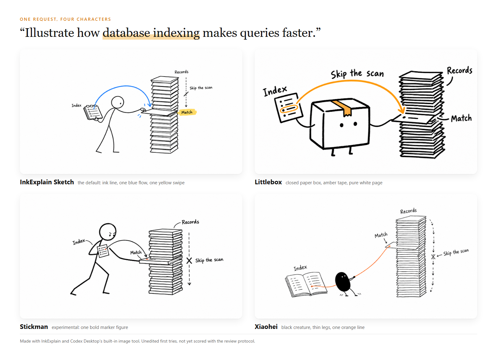

# InkExplain

**Ideas made visual.**

Turn code, docs, and ideas into hand-drawn illustrations with AI agents.

<!-- inkexplain:languages:start -->
<details>
<summary>Languages</summary>

**English** · [Español](./readmes/README.es.md) · [Português](./readmes/README.pt.md) · [Deutsch](./readmes/README.de.md) · [Français](./readmes/README.fr.md) · [简体中文](./readmes/README.zh.md) · [繁體中文](./readmes/README.zh-Hant.md) · [한국어](./readmes/README.ko.md) · [日本語](./readmes/README.ja.md) · [العربية](./readmes/README.ar.md) · [Русский](./readmes/README.ru.md) · [Türkçe](./readmes/README.tr.md) · [Українська](./readmes/README.uk.md)

</details>
<!-- inkexplain:languages:end -->

## Install

```bash
npx skills add agustinpabon/InkExplain --skill inkexplain
```

Then ask your agent in plain words:

> Use InkExplain with Littlebox to illustrate how database indexing works.

InkExplain chooses the character, plans the picture, writes the prompt, and hands it to your agent's own image tool. The image is saved in your project, in `assets/<slug>-littlebox/`, next to its prompt. In Codex you can also start with `$inkexplain`. Leave the character out and you get the default style, InkExplain Sketch.

<sub>The installer is the open [skills CLI](https://skills.sh) and needs Node.js 22.20 or newer. It sends anonymous install counts unless you set `DISABLE_TELEMETRY=1`; InkExplain itself collects nothing. Without Node.js, copy the folder `skills/inkexplain/` into your agent's skills folder.</sub>

<picture>
  <source media="(max-width: 600px) and (prefers-color-scheme: dark)" srcset="assets/brand/readme-hero-mobile-dark.png">
  <source media="(max-width: 600px)" srcset="assets/brand/readme-hero-mobile-light.png">
  <source media="(prefers-color-scheme: dark)" srcset="assets/brand/readme-hero-desktop-dark.png">
  
</picture>

<sub>Four real renders from InkExplain and Codex Desktop's built-in image tool, unedited, in a layout made for this page: [Sketch](assets/examples/sketch-database-index.png), [Littlebox](assets/examples/littlebox-database-index.png), [Stickman](assets/examples/stickman-database-index.png), [Xiaohei](assets/examples/xiaohei-database-index.png). They are first tries, not scored with the [review protocol](docs/visual-review.md).</sub>

## Characters

Name one in your request. InkExplain loads that character's look, motion, and rules, and keeps them the same across every image in a series.

<!-- inkexplain:archetypes:start -->
<table>
<tr>
<td width="25%" valign="top"><br><b>InkExplain Sketch</b> · default<br>Black ink line, one blue flow, one yellow swipe.<br><sub>MIT · InkExplain contributors</sub></td>
<td width="25%" valign="top"><br><b>Littlebox</b><br>A closed paper box on a pure white page.<br><sub>MIT · okooo5km</sub></td>
<td width="25%" valign="top"><br><b>Stickman</b> · <code>experimental</code><br>One bold marker figure that acts out the idea.<br><sub>MIT · InkExplain contributors</sub></td>
<td width="25%" valign="top"><br><b>Xiaohei</b><br>A small black creature doing serious, absurd work.<br><sub>MIT · Ian</sub></td>
</tr>
<tr>
<td width="25%" valign="top"><b>Ferris</b><br>The Rust community crab.<br><sub>CC0 public-domain dedication · Karen Rustad Tölva</sub></td>
<td width="25%" valign="top"><b>Go Gopher</b><br>The Go gopher in sparse sketches.<br><sub>CC BY 4.0 (the design); CC BY 3.0 (the bundled reference drawing) · Renee French (design); Takuya Ueda (bundled drawing)</sub></td>
<td width="25%" valign="top"><b>Tux</b><br>Tux, the Linux penguin.<br><sub>Free to use and modify with credit to Larry Ewing and The GIMP · Larry Ewing</sub></td>
<td width="25%" valign="top"><b>OpenClaw</b><br>The red OpenClaw mascot with claw arms.<br><sub>MIT · OpenClaw Foundation</sub></td>
</tr>
</table>
<!-- inkexplain:archetypes:end -->

Previews are downscaled copies of the renders above; Ferris, Go Gopher, Tux, and OpenClaw have none yet, and no stand-in is drawn for them. Stickman is experimental: its design is complete, but no render of it has been reviewed. Third-party characters keep their owners' credit and terms, in [ATTRIBUTIONS.md](ATTRIBUTIONS.md) and [docs/provenance.md](docs/provenance.md).

## How it works

1. **Read.** It finds the ideas in your text or code that deserve a picture, one idea per image.
2. **Plan.** Each idea becomes something the character physically does, with a few short labels.
3. **Prompt.** It fills the character's own prompt template, so the identity and style text is the same every time.
4. **Draw.** Your agent's image tool makes each image, one call per image. InkExplain checks the saved file and reports its path.

## Works with

- **Codex Desktop** generates images. Confirmed.
- **Cursor** has an Agent image tool. Not tested.
- **Claude Code and Gemini CLI** have no built-in image generator. InkExplain writes ready-to-paste prompts, or uses an image tool you have already connected.
- Any other agent that reads `SKILL.md` packages gets the same behavior: it uses an image tool if one is callable, and says plainly when none is.

InkExplain needs no API key and never turns on a paid service. Details, and what each host was actually seen doing, are in [docs/usage.md](docs/usage.md#image-generation-by-host).

## Learn more

- [Using InkExplain](docs/usage.md): modes, output folders, the prompt helper
- [Code walkthroughs](docs/walkthroughs.md): four snippets taken to a finished prompt
- [Adding a character](docs/adding-an-archetype.md): `npm run archetype:add -- --id example-fox --name "Example Fox"` scaffolds one
- [Limits and known issues](docs/limitations.md)
- [Evaluation](docs/evaluation.md) and [reviewing real renders](docs/visual-review.md)
- [Security](SECURITY.md), [Contributing](CONTRIBUTING.md), [Architecture](docs/architecture.md)

## Credits and license

<!-- inkexplain:credits:start -->
InkExplain builds on three earlier MIT-licensed projects: [Visual IP Illustrations](https://github.com/yangchuansheng/visual-ip-illustrations) by yangchuansheng, [Ian Xiaohei Illustrations](https://github.com/helloianneo/ian-xiaohei-illustrations) by Ian, and [5km Littlebox Illustrations](https://github.com/okooo5km/5km-littlebox-illustrations) by okooo5km. Its gallery images are unmodified copies from the first two. Third-party characters and marks remain the property of their respective owners. See [ATTRIBUTIONS.md](ATTRIBUTIONS.md) for the origins, individual character notices, and licenses.
<!-- inkexplain:credits:end -->

InkExplain is released under the [MIT License](LICENSE).
