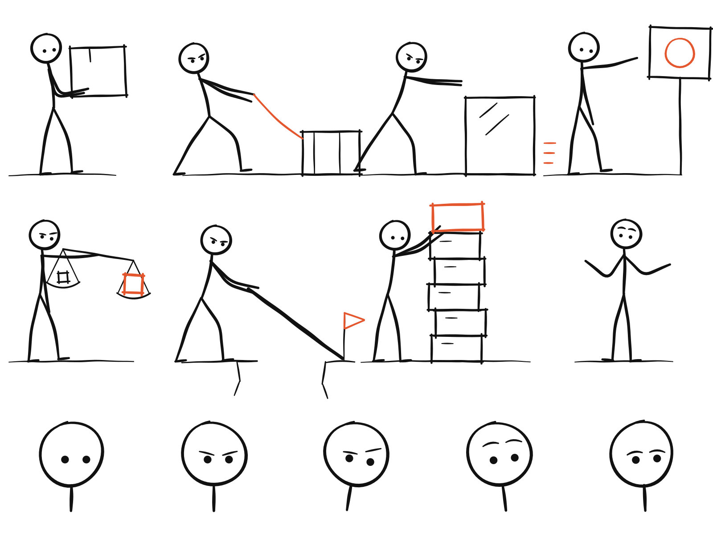

# Visual system

InkExplain makes complex ideas understandable through visual thinking. This page explains the principles behind every archetype and the identity of InkExplain's own style. The agent-facing rules live in `skills/inkexplain/references/`.

## Principles shared by every archetype

1. **One idea per image.** An illustration that explains two things explains neither.
2. **An actor performs the idea.** A character, a hand, or a machine does something physical that *is* the idea: weighing, filtering, bridging, unpacking. If the actor could be removed without losing the meaning, it was decoration.
3. **Everyday metaphors over technical icons.** Pipes, funnels, scales, ladders, and mailboxes explain systems better than servers, dashboards, and screenshots.
4. **Whitespace is structure.** The main action fills about half the canvas, and at least a third stays empty.
5. **Few words, in the reader's language.** Two to six short handwritten labels; no titles, no paragraphs.
6. **Consistency across a series.** The style, actor, and palette stay fixed; the metaphors change.

These live in `references/workflow/`. Every archetype inherits them; archetype packs add only what is specific to their character, motion, and style.

## InkExplain Sketch

The default archetype is InkExplain's own visual identity: an explainer sketching on clean paper.

| Element | Rule |
|---|---|
| Canvas | 16:9 by default, clean white, no texture |
| Line | hand-drawn black ink, medium-thin, slight wobble, rounded ends |
| Movement | explainer blue `#2F6FED`, only on arrows, paths, and motion |
| Emphasis | one translucent highlighter-yellow swipe `#FFD84D` behind the single most important label or object |
| Problems | signal red `#E5484D`, only for a warning or breakpoint |
| Actor | the ink figure (round head, single-stroke body, no features), hands, or the working object |
| Labels | neat handwritten print, two to six, in the user's language |

The highlighter swipe is the signature: in every InkExplain Sketch image, the reader's eye lands first on the one thing the author would underline.

The style needs no mascot, so it suits any topic and any brand. Character archetypes remain available when a character helps, but they are never required. For a recurring human-like figure without a third-party character, see Stickman below.

## Stickman

Stickman is InkExplain's second house style, for when you want the same recognizable character in every image of a series. It is a stick figure with a fixed contract: an open round head, two dot eyes, a curved spine, bendy two-segment limbs, and foot ticks, drawn in one bold black marker on a pure white page with at most one vermilion accent. Its whole body leans into the idea.

| | InkExplain Sketch | Stickman |
|---|---|---|
| Pick it when | you want a brand-neutral look, and the idea may be better acted by hands or a machine than by a person | you want one recognizable figure acting out every idea in a series |
| Actor | a neutral ink figure, a pair of hands, or the working object | always the same stick figure |
| Line | medium-thin ink pen | one bold black marker, a little heavier on the figure |
| Color | black ink, explainer blue for movement, one highlighter swipe, signal red for problems | black ink and at most one vermilion accent |
| Face | none, or two dots at most | two dot eyes and optional brow strokes, never a mouth |
| Signature | the highlighter swipe | the pose: the figure leans into the work |

Both draw on a white page and avoid mascots, so neither needs a character license. Ask for "a stickman" or "a stick figure" to get the second; name nothing to get the first.

The sheet above is hand-built vector art, not an image-model render. The Stickman pack bundles a PNG copy as an identity and proportion reference for image tools that accept one. Stickman is `experimental` until its renders have been reviewed; the rules for promoting it are in [adding-an-archetype.md](adding-an-archetype.md#5-validate).

## Brand assets

`assets/brand/` holds the InkExplain mark, the older hero scene, and the editable source of the Stickman pose sheet, drawn as hand-coded SVG in the same palette. They are original to InkExplain and use no third-party characters.

## Character archetypes

Each character archetype keeps its own identity, motion, and style rules: Littlebox's marker-drawn paper box on a pure white page (another background only when you ask for one), Xiaohei's deadpan solid-black creature on a pure white page, and the community mascots, each with its credit and restrictions. Identity lives in `identity.md`, movement in `motion-and-acting.md`, drawing rules in `style.md`, and rights in `rights.md`, so a character can be reviewed or retired without touching the shared method.
