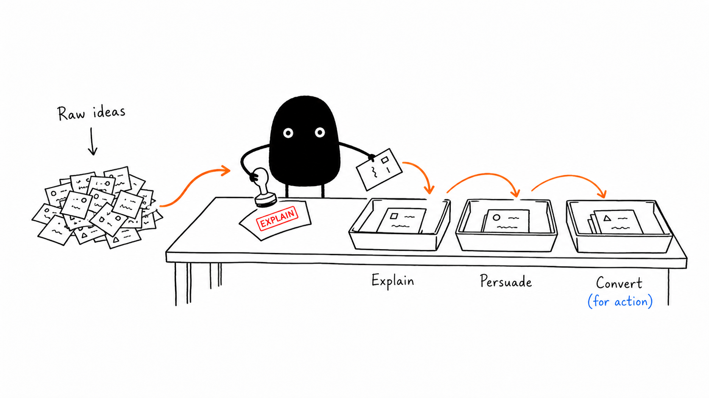
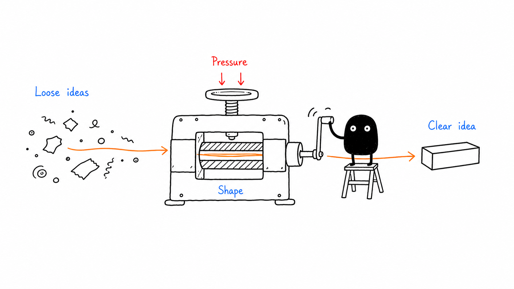

<p align="center">
  
</p>

# InkExplain

*아이디어를 눈에 보이게.*

AI로 복잡한 아이디어를 아름답고 일관된 손그림 일러스트로 바꿔 보세요.

<!-- inkexplain:languages:start -->
[English](../README.md) | [Español](./README.es.md) | [Português](./README.pt.md) | [Deutsch](./README.de.md) | [Français](./README.fr.md) | [简体中文](./README.zh.md) | [繁體中文](./README.zh-Hant.md) | **한국어** | [日本語](./README.ja.md) | [العربية](./README.ar.md) | [Русский](./README.ru.md) | [Türkçe](./README.tr.md) | [Українська](./README.uk.md)
<!-- inkexplain:languages:end -->

InkExplain은 AI 에이전트를 위한 시각적 사고(visual reasoning) 스킬입니다. 글이나 문서, 혹은 아이디어 하나를 건네면 그림으로 그릴 만한 아이디어를 추려 내고, 각 아이디어를 캐릭터가 직접 수행하는 물리적 동작으로 바꾸며, 시리즈 전체의 일관성을 지켜 주는 프롬프트를 작성합니다. 에이전트에 이미지 생성 도구가 있다면 이미지 생성과 검토, 저장까지 맡습니다.

## 주요 기능

- **기획**: 샷 리스트를 만듭니다. 각 이미지가 들어갈 위치, 그 이미지가 전달할 아이디어, 그리고 그 아이디어를 보여 줄 물리적 은유를 정합니다.
- **주인공 연출**: 모든 이미지에는 아이디어를 연기하는 캐릭터나 손, 혹은 기계가 하나씩 등장하며, 결정적인 순간의 자세로 그려집니다.
- **프롬프트 작성**: 시리즈를 하나로 묶어 주는 프롬프트를 씁니다. 아키타입은 하나, 스타일도 하나, 은유는 이미지마다 새롭게.
- **생성 및 검토**: 에이전트의 이미지 도구로 이미지를 생성하고 검토한 뒤, 정해진 규칙에 따른 이름으로 저장합니다.
- **수정**: 일러스트를 손봅니다. 잘못 들어간 제목을 지우고, 라벨을 바로잡고, 복잡한 장면을 단순하게 정리하고, 망가진 캐릭터를 원래대로 되돌립니다.

기술 글, 제품과 아키텍처 설명, 워크플로, 비교, 인과 관계, 강의 자료, 그리고 일관된 시각적 톤이 필요한 긴 글에 잘 어울립니다.

## 작동 방식

1. **아키타입 선택**: 캐릭터와 그 움직임, 그리고 비주얼 스타일을 고릅니다. 따로 요청하지 않으면 InkExplain은 자체 하우스 스타일인 InkExplain Sketch를 사용합니다.
2. **개념 추출**: 핵심 논지와 인지적 앵커를 뽑아냅니다. 막히는 지점, 인계, 트레이드오프, 루프, 전후 변화 같은 것들입니다.
3. **기획**: 아이디어마다 이미지 한 장을 기획합니다. 이미지마다 구조 유형, 구도 그리드 위의 위치, 그리고 주인공이 직접 연기하는 일상적인 은유를 정합니다.
4. **프롬프트 조립**: 아키타입의 템플릿에서 정해진 순서대로 프롬프트를 조립한 다음, 도구 호출 한 번에 이미지 한 장씩 생성합니다.
5. **검토**: 모든 이미지를 공통 QA 체크리스트와 아키타입 고유의 점검 항목에 비추어 확인하고, 수정하거나 다시 생성합니다.
6. **저장 및 보고**: 워크스페이스의 `assets/<article-slug>-…/`에 저장하고 결과를 보고합니다.

기획과 생성은 일부러 분리되어 있습니다. InkExplain에는 이미지 모델이 들어 있지 않으며, 에이전트가 제공하는 이미지 생성 도구를 사용합니다. 그런 도구가 없으면 **프롬프트 모드**로 전환해, 바로 실행할 수 있는 완성된 프롬프트를 건네줍니다. 실제로 생성하지 않은 이미지를 생성했다고 주장하는 일은 결코 없습니다.

## 설치

```bash
npx skills add agustinpabon/InkExplain --skill inkexplain
```

이 명령은 오픈 [skills CLI](https://skills.sh)를 사용합니다(Node.js 22.20 이상). 사용 중인 에이전트(예: Claude Code, Codex, Cursor, Gemini CLI, GitHub Copilot, OpenCode, Windsurf)를 감지해, 그 에이전트가 읽는 폴더에 스킬을 복사합니다. `-g`를 붙이면 모든 프로젝트에 설치하고, `-a <agent>`를 붙이면 에이전트를 직접 고릅니다. 기본적으로 CLI는 익명 사용 텔레메트리를 보내며, `DISABLE_TELEMETRY=1`을 설정하면 끌 수 있습니다. InkExplain 자체는 아무것도 수집하지 않습니다.

Node.js가 없다면 `skills/inkexplain/` 폴더를 에이전트의 스킬 폴더에 직접 복사하세요. 폴더 목록은 "지원 환경" 절에 있습니다.

## 사용법

Codex에서는 `$inkexplain`으로 스킬을 호출합니다. Claude Code를 비롯한 다른 호스트에서는 InkExplain을 이름으로 부르거나 하려는 작업을 설명하세요. 요청이 스킬 설명과 일치하면 에이전트가 스킬을 불러옵니다.

```text
$inkexplain 이 글에 들어갈 일러스트를 기획해 주세요. 아직 생성하지는 마세요.

<글 붙여넣기>
```

```text
$inkexplain 이 게시물에 이미지 네 장으로 일러스트를 넣고 프로젝트에 저장해 주세요.
```

```text
$inkexplain Ferris를 사용해서 다음 내용을 이미지 한 장으로 그려 주세요: "소유권이란 한 번에 딱 하나의 소유자만 존재한다는 뜻이다."
```

```text
$inkexplain 프롬프트 모드: 제 이미지 도구에 붙여넣을 수 있도록 이미지 세 장 분량의 프롬프트를 작성해 주세요.
```

모든 아키타입과 혼합 요청을 포함한 더 많은 예시는 [examples/prompts.md](../examples/prompts.md)에 있습니다.

## 아키타입

아키타입은 누가 아이디어를 연기하는지, 어떻게 움직이는지, 장면을 어떻게 그리는지를 정합니다. 기본값은 InkExplain Sketch이며, 나머지 아키타입은 모두 이름으로 선택합니다. 한 이미지 안에서 여러 아키타입이 섞이는 일은 없습니다.

<!-- inkexplain:archetypes:start -->
| 아키타입 | 카테고리 | 스타일 요약 | 법적 상태 |
|---|---|---|---|
| InkExplain Sketch (`ink`, 기본값) | `house-style` | InkExplain's own brand-neutral style: black ink line art, one explainer-blue flow accent, a single highlighter-yellow emphasis, and a neutral ink figure or hands that perform the idea. | `active` · MIT · InkExplain contributors |
| Littlebox (`littlebox`) | `tribute-character` | A closed paper-box character in thick rough marker on a pure white page that turns ideas into collecting, packaging, sorting, and delivering. | `active` · MIT · okooo5km |
| Stickman (`stickman`) | `house-style` | InkExplain's own recurring stick figure: a bold black marker line, a round head with two dot eyes, and bendy limbs that act out the idea on a pure white page, with at most one vermilion accent. | `experimental` · MIT · InkExplain contributors |
| Xiaohei (`xiaohei`) | `mascot` | Ian's Xiaohei, a small solid-black creature with white dot eyes and thin legs, doing serious, slightly absurd work inside sparse black-ink sketches on a pure white page. | `active` · MIT · Ian |
| Ferris (`ferris`) | `mascot` | Ferris the Rustacean, the Rust community crab, performing the idea in sparse hand-drawn article sketches without Rust logos or endorsement cues. | `active` · CC0 public-domain dedication · Karen Rustad Tölva |
| OpenClaw (`openclaw`) | `mascot` | The OpenClaw mascot, a red round character with claw-like arms, two antennae, and cyan pupils, performing the idea in sparse hand-drawn article sketches. | `active` · MIT · OpenClaw Foundation |
| Go Gopher (`gopher`) | `mascot` | The Go gopher designed by Renee French performing the idea in sparse hand-drawn article sketches, credited and free of Go logos or endorsement claims. | `active` · CC BY 4.0 (the design); CC BY 3.0 (the bundled reference drawing) · Renee French |
| Tux (`tux`) | `mascot` | Tux, the Linux penguin created by Larry Ewing, performing the idea in sparse article sketches without distro logos, product graphics, or endorsement claims. | `active` · Free to use and modify with credit to Larry Ewing and The GIMP · Larry Ewing |
<!-- inkexplain:archetypes:end -->

- **카테고리**: `house-style`은 InkExplain 고유의 스타일입니다. `mascot`은 크레디트를 표기하고 사용하는 프로젝트 또는 커뮤니티 마스코트입니다. `tribute-character`는 서드파티가 만든 캐릭터로, 그 권리 범위 안에서 그려집니다. `animation-preset`은 독자적인 모션 및 연출 프리셋을 위해 예약되어 있습니다.
- **상태**: `active` 아키타입은 바로 사용할 수 있습니다. `experimental` 아키타입은 이름으로 지정할 때만 선택되며, 결과물을 전달할 때마다 그 사실이 표시됩니다. `gated-authorized` 아키타입은 이름으로 지정했을 때만, 그리고 본인이 가진 권한 범위 안에서만 사용되며, 권한이 기록되지 않은 상태로는 절대 공개되지 않습니다.

모든 아키타입의 별칭, 모션 DNA, 스타일 시트, 크레디트, 사용 제한은 [routing.md](../skills/inkexplain/references/routing.md)에 정리되어 있으며, 이 파일은 아키타입 레지스트리인 [registry.json](../skills/inkexplain/registry.json)에서 생성됩니다.

## 예시 갤러리

Xiaohei의 예시 이미지를 수정 없이 보여 줍니다. 다른 캐릭터의 예시 이미지는 검토를 마친 뒤에 공개합니다.

| 물고기 한 마리, 여러 쓰임 | 목적별 분류 | 아이디어 프레스 |
|---|---|---|
|  |  |  |

<!-- inkexplain:gallery-credits:start -->
Xiaohei는 Ian Xiaohei Illustrations에 나오는 Ian의 캐릭터입니다(MIT). 영어 라벨 이미지는 Visual IP Illustrations(MIT)가 공개한 이미지의 사본이고, 중국어 라벨 이미지는 Ian이 직접 만든 이미지의 사본입니다. 모두 수정 없이 [examples/gallery](../examples/gallery)에 있습니다([각 이미지의 출처](../docs/provenance.md)). 다른 캐릭터의 예시 이미지는 검토가 끝날 때까지 공개하지 않습니다.
<!-- inkexplain:gallery-credits:end -->

## 새 캐릭터와 애니메이션 스타일 추가하기

아키타입은 데이터와 Markdown으로 이루어져 있습니다. 새 아키타입을 추가할 때 검증기 코드를 작성할 필요는 없습니다.

1. **등록하기.** [`skills/inkexplain/registry.json`](../skills/inkexplain/registry.json)의 `archetypes`에 항목을 추가합니다. id, 이름, 카테고리, 상태, 요약, 별칭, 출력 접미사, `motionDna`, `styleSheet`, `legalNotice`, `sampleGates`, 그리고 `contract`의 정체성 마커와 격리 마커를 넣습니다. 서드파티 캐릭터에는 권리자, 라이선스, 저작자 표시 조건이 필요하며, 보호되는 캐릭터는 `gated-authorized` 상태로 시작합니다.
2. **팩 작성하기.** `skills/inkexplain/references/archetypes/<id>/`를 만들고 다섯 개의 팩 파일 `rights.md`, `identity.md`, `style.md`, `motion-and-acting.md`, `prompts.md`를 작성합니다. 기존 팩의 구조를 그대로 따르면 됩니다. 그 밖의 모든 것은 `references/workflow/`의 공통 방법론이 이미 다루고 있습니다.
3. **생성하고 검증하기.** [ATTRIBUTIONS.md](../ATTRIBUTIONS.md)에 크레디트를, [examples/prompts.md](../examples/prompts.md)에 예시를 추가한 다음, `npm run build:docs`와 `npm run check`를 실행합니다. 위의 아키타입 표와 `routing.md`, 그리고 모든 번역본은 자동으로 갱신됩니다.

완전한 레지스트리 항목 예시와 먼저 답해야 할 권리 관련 질문을 포함한 전체 안내는 [docs/adding-an-archetype.md](../docs/adding-an-archetype.md)에 있습니다.

## 출력 규칙

- 각 아키타입은 워크스페이스 안의 자체 폴더에 결과를 저장합니다. 기본 아키타입은 `assets/<article-slug>-illustrations/`, 그 밖의 아키타입은 `assets/<article-slug>-<id>/`를 사용합니다.
- 파일 이름은 번호를 붙인 영어 슬러그입니다: `01-two-breakpoints.png`, `02-handoff-path.png`.
- 기존 파일은 절대 덮어쓰지 않습니다. 새 버전에는 다음 번호나 `-v2` 접미사가 붙습니다.
- 프로젝트 안에서 프롬프트 모드를 사용하면 프롬프트가 같은 폴더에 `prompts.md`로 저장됩니다.
- 결과물을 전달할 때는 항상 짧은 보고로 마무리합니다. 보고에는 사용한 아키타입, 이미지와 각각의 목적, 파일 경로, 가장 효과적인 이미지와 생략해도 되는 이미지, 미해결 문제, 그리고 서드파티 아키타입이라면 권리 관련 안내 사항이 담깁니다.

## 지원 환경

| 에이전트 | 프로젝트 안의 스킬 폴더 |
|---|---|
| Claude Code | `.claude/skills/inkexplain` |
| Codex | `.agents/skills/inkexplain` |
| Cursor | `.agents/skills/inkexplain`; Cursor는 `.claude/skills/`와 `.codex/skills/`도 읽습니다 |
| Gemini CLI, GitHub Copilot, OpenCode | `.agents/skills/inkexplain` |
| Windsurf | `.windsurf/skills/inkexplain` |
| `SKILL.md` 패키지를 읽는 다른 에이전트 | 해당 에이전트의 스킬 폴더 |

`-g`를 쓰면 CLI는 에이전트의 개인 폴더에 설치합니다(예: Claude Code는 `~/.claude/skills/`, Codex는 `~/.agents/skills/`).

테스트한 것: skills CLI가 위의 각 에이전트에 스킬을 올바르게 배치하고, Claude Code가 이를 목록에 표시합니다. 설치된 스킬을 가리켜 준 새 Claude Code 에이전트 세션이 이미지 도구 없이 프롬프트 모드로 15개의 요청에서 스킬을 올바르게 따랐습니다([평가](../docs/evaluation.md)). 테스트하지 않은 것: 호스트가 평범한 요청만으로 스킬을 스스로 불러오는지, Codex, Cursor, Gemini CLI, GitHub Copilot, OpenCode, Windsurf 안에서 스킬 실행, 그리고 어떤 이미지 도구로든 이미지 생성.

## 사용자 지정

- **요청별**: 아키타입, 이미지 수, 가로세로 비율, 라벨 언어, 글의 슬러그를 평소 쓰는 말로 지정할 수 있습니다.
- **하우스 스타일**: InkExplain Sketch는 `skills/inkexplain/references/archetypes/ink/`에 있습니다. `style.md`와 `prompts.md`는 함께 수정하고, `registry.json`의 팔레트도 그에 맞게 함께 고쳐 두세요.
- **새 아키타입**: [새 캐릭터와 애니메이션 스타일 추가하기](../docs/adding-an-archetype.md)를 참고하세요.

## 요구 사항

- `SKILL.md` 스킬 패키지를 지원하는 에이전트.
- 이미지를 생성하려면: 해당 에이전트가 사용할 수 있는 이미지 생성 도구.
- 개발하려면: Node.js 22 이상. 따로 설치할 의존성은 없습니다.

## 제한 사항

- InkExplain에는 이미지 모델이 포함되어 있지 않습니다. 이미지 품질은 에이전트가 사용하는 도구에 따라 달라집니다.
- 이미지 모델은 라벨 글자를 자주 틀리며, 라틴 문자가 아닌 문자에서 특히 심합니다. 라벨은 짧게 쓰고 꼭 검토하세요.
- InkExplain Sketch에는 아직 검토를 거친 샘플 렌더링이 없습니다.
- 서드파티 아키타입에는 권리자가 정한 제한이 따릅니다. 게이트 아키타입은 본인의 권한 범위 안에서 사용하기 위한 것이며, InkExplain은 이러한 아키타입의 샘플을 공개하지 않습니다.
- README 번역본은 AI의 도움을 받아 작성되었으며, 전문 번역가의 검토를 거치지 않았습니다. 자동 생성되는 표는 레지스트리 데이터를 영어 그대로 유지합니다.

## 개발

```bash
npm test               # unit, check, CLI, and repository tests (Node's built-in runner)
npm run validate       # validate the repository and skill package
npm run build:docs     # regenerate routing.md, the README archetype tables, and language selectors
npm run check          # everything CI runs
```

아키텍처, 점진적 공개(progressive disclosure) 모델, 검사 목록, 릴리스 절차는 [docs/architecture.md](../docs/architecture.md)와 [docs/release-checklist.md](../docs/release-checklist.md)에 정리되어 있습니다. 기여자와 에이전트를 위한 지침은 [AGENTS.md](../AGENTS.md)에 있습니다.

## 크레디트 및 라이선스

<!-- inkexplain:credits:start -->
InkExplain은 MIT 라이선스로 공개된 세 가지 기존 프로젝트를 바탕으로 합니다. yangchuansheng의 [Visual IP Illustrations](https://github.com/yangchuansheng/visual-ip-illustrations), Ian의 [Ian Xiaohei Illustrations](https://github.com/helloianneo/ian-xiaohei-illustrations), okooo5km의 [5km Littlebox Illustrations](https://github.com/okooo5km/5km-littlebox-illustrations)입니다. 갤러리 이미지는 앞의 두 프로젝트에서 가져온 수정 없는 사본입니다. 제3자의 캐릭터와 상표는 각 소유자의 자산입니다. 프로젝트의 기원과 각 캐릭터의 고지 및 라이선스는 [ATTRIBUTIONS.md](../ATTRIBUTIONS.md)를 참고하세요.
<!-- inkexplain:credits:end -->

InkExplain은 [MIT 라이선스](../LICENSE)에 따라 배포됩니다.
