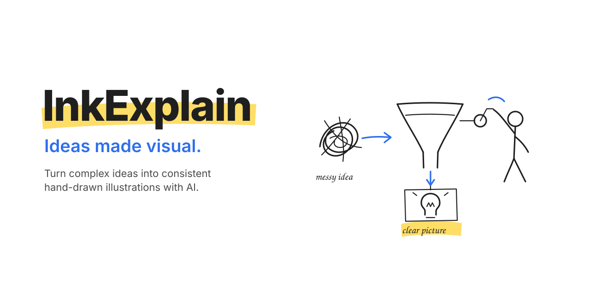
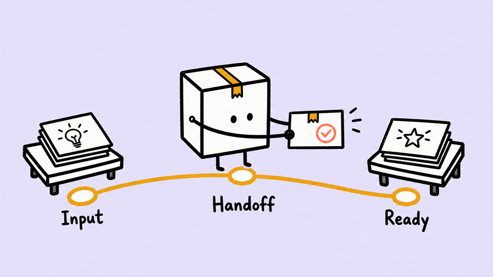
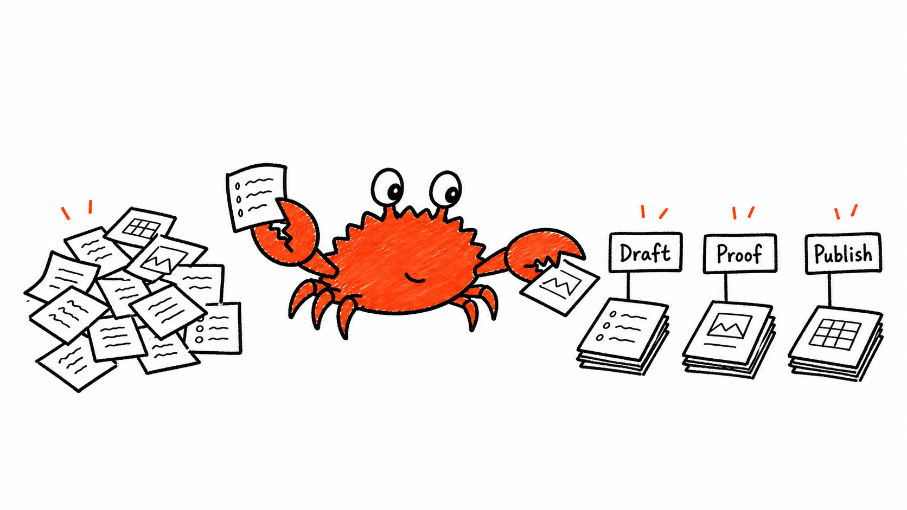
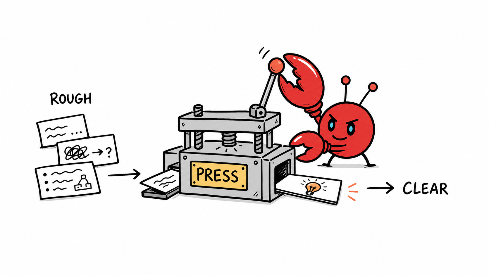
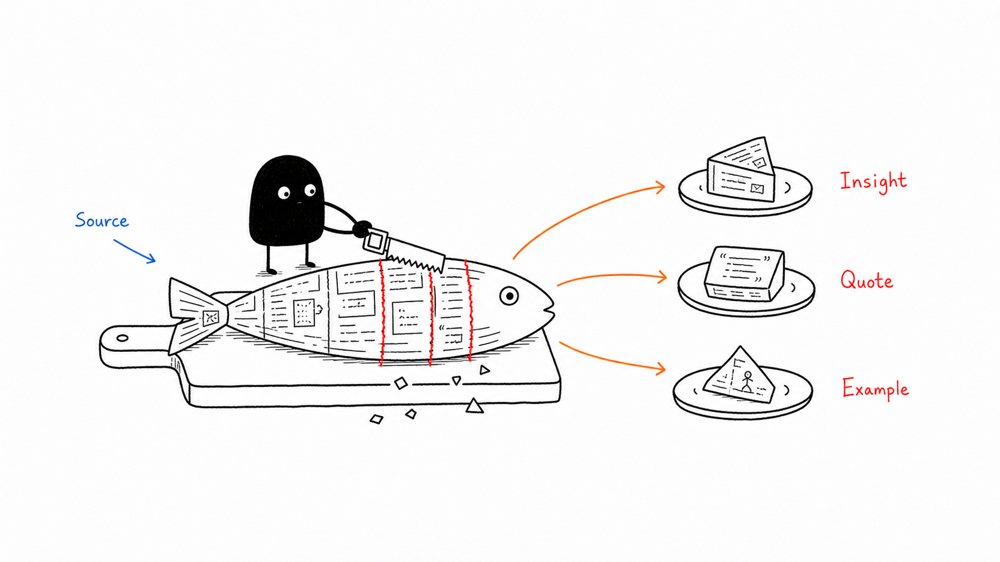

<p align="center">
  
</p>

# InkExplain

*Görselleşen fikirler.*

Karmaşık fikirleri yapay zekâ ile güzel ve tutarlı el çizimi illüstrasyonlara dönüştürün.

<!-- inkexplain:languages:start -->
[English](../README.md) | [Español](./README.es.md) | [Português](./README.pt.md) | [Deutsch](./README.de.md) | [Français](./README.fr.md) | [简体中文](./README.zh.md) | [繁體中文](./README.zh-Hant.md) | [한국어](./README.ko.md) | [日本語](./README.ja.md) | [العربية](./README.ar.md) | [Русский](./README.ru.md) | **Türkçe** | [Українська](./README.uk.md)
<!-- inkexplain:languages:end -->

InkExplain, yapay zekâ ajanları için bir görsel akıl yürütme becerisidir (skill). Ona bir makale, bir belge ya da tek bir fikir verin: çizmeye değer fikirleri ayıklar, her birini bir karakterin gerçekleştirdiği fiziksel bir eyleme dönüştürür ve bütün bir serinin tutarlı kalmasını sağlayan istemler (prompt) yazar. Ajanınızın bir görsel üretme aracı varsa görselleri üretir, gözden geçirir ve kaydeder de.

## Ne yapar

- **Planlama**: Her görselin nereye gireceğini, taşıdığı fikri ve bu fikri gösteren somut metaforu belirleyen bir çekim listesi hazırlar.
- **Kahramanı yönetme**: Her görselde fikri canlandıran tek bir karakter, el ya da makine yer alır ve bu kahraman, belirleyici anındaki pozuyla çizilir.
- **İstem yazımı**: Tek arketip, tek stil ve her görsel için yeni bir metaforla seriyi bir arada tutan istemler yazar.
- **Üretim ve inceleme**: Görselleri ajanınızın görsel aracıyla üretir ve gözden geçirir, ardından öngörülebilir adlarla kaydeder.
- **Onarım**: İllüstrasyonları onarır; istenmeyen başlıkları kaldırır, etiketleri düzeltir, kalabalık sahneleri sadeleştirir ve bozulan bir karakteri eski hâline getirir.

Teknik makalelere, ürün ve mimari anlatımlarına, iş akışlarına, karşılaştırmalara, neden-sonuç ilişkilerine, ders materyallerine ve tutarlı bir görsel dil gerektiren uzun metinlere uygundur.

## Nasıl çalışır

1. **Arketip seçimi**: Bir karakter, onun hareket biçimi ve görsel stili. Özel bir istek yoksa InkExplain kendi özgün stilini, yani InkExplain Sketch'i kullanır.
2. **Kavramı çıkarma**: Ana tez ile aksama noktaları, devir teslimler, ödünleşimler, döngüler ve önce-sonra değişimleri gibi bilişsel çapalar çıkarılır.
3. **Planlama**: Her fikir için bir görsel planlanır; her görselin bir yapı türü, kompozisyon ızgarasında bir yeri ve sahnenin kahramanının canlandırdığı gündelik bir metaforu olur.
4. **İstemi oluşturma**: İstem, arketipin şablonundan sabit bir sırayla oluşturulur; ardından her araç çağrısında tek bir görsel üretilir.
5. **İnceleme**: Her görsel, ortak kalite kontrol (QA) listesine ve arketipin kendine özgü kontrollerine göre incelenir; gerekirse onarılır ya da yeniden üretilir.
6. **Kaydetme ve raporlama**: Sonuçlar çalışma alanınızdaki `assets/<article-slug>-…/` klasörüne kaydedilir ve raporlanır.

Planlama ve üretim bilerek birbirinden ayrılmıştır. InkExplain bir görsel modeli içermez; ajanınızın sağladığı görsel üretme aracını kullanır. Böyle bir araç yoksa **istem moduna** (prompt mode) geçer ve size eksiksiz, çalıştırılmaya hazır istemler verir. Üretmediği bir görseli ürettiğini asla iddia etmez.

## Kurulum

Beceri, `skills/inkexplain/` klasörüdür. Bu klasörü, ajanınızın becerileri aradığı konuma kopyalayın.

Bu deponun yerel bir kopyasından:

```bash
# Codex
mkdir -p "${CODEX_HOME:-$HOME/.codex}/skills"
cp -R skills/inkexplain "${CODEX_HOME:-$HOME/.codex}/skills/"

# Claude Code (personal skills; use .claude/skills/ inside a project to scope it)
mkdir -p ~/.claude/skills
cp -R skills/inkexplain ~/.claude/skills/

# Cursor (personal skills; use .cursor/skills/ inside a project to scope it)
mkdir -p ~/.cursor/skills
cp -R skills/inkexplain ~/.cursor/skills/
```

Bu deponun herkese açık olarak `agustinpabon/inkexplain` adresinde yayımlanması planlanıyor. Henüz yayımlanmadı; yayımlandığında [skills CLI](https://skills.sh) aracının beceriyi şu komutla kurabilmesi bekleniyor:

```bash
npx skills add agustinpabon/inkexplain --skill inkexplain
```

## Kullanım

Codex'te beceriyi `$inkexplain` ile çağırın. Claude Code'da ve diğer ortamlarda InkExplain'i adıyla isteyin ya da görevi tarif edin; istek becerinin açıklamasıyla eşleştiğinde ajan beceriyi yükler.

```text
$inkexplain Bu makale için illüstrasyonları planla. Henüz görsel üretme.

<makaleyi buraya yapıştırın>
```

```text
$inkexplain Bu yazıyı dört görselle resimle ve görselleri projeye kaydet.
```

```text
$inkexplain Ferris'i kullan. Şu fikir için tek bir görsel: "sahiplik, aynı anda tam olarak tek bir sahip demektir."
```

```text
$inkexplain İstem modu: görsel aracıma yapıştırabileceğim üç görsel için istemler yaz.
```

Tüm arketipleri ve karma istekleri kapsayan daha fazla örneği [examples/prompts.md](../examples/prompts.md) dosyasında bulabilirsiniz.

## Arketipler

Arketip, fikri kimin canlandırdığını, nasıl hareket ettiğini ve sahnenin nasıl çizildiğini belirler. Varsayılan arketip InkExplain Sketch'tir; diğer tüm arketipler adıyla seçilir. Arketipler tek bir görselde asla karışmaz.

<!-- inkexplain:archetypes:start -->
| Arketip | Kategori | Stil özeti | Hukuki durum |
|---|---|---|---|
| InkExplain Sketch (`ink`, varsayılan) | `house-style` | InkExplain's own brand-neutral style: black ink line art, one explainer-blue flow accent, a single highlighter-yellow emphasis, and a neutral ink figure or hands that perform the idea. | `active` · MIT · InkExplain contributors |
| Xiaohei (`xiaohei`) | `mascot` | Ian's Xiaohei, a small solid-black creature with white dot eyes and thin legs, doing serious, slightly absurd work inside sparse black-ink sketches on a pure white page. | `active` · MIT · Ian |
| Littlebox (`littlebox`) | `tribute-character` | A closed paper-box character in thick rough marker on pale sky-blue or lavender backgrounds that turns ideas into collecting, packaging, sorting, and delivering. | `active` · MIT · okooo5km |
| Ferris (`ferris`) | `mascot` | Ferris the Rustacean, the Rust community crab, performing the idea in sparse hand-drawn article sketches without Rust logos or endorsement cues. | `active` · CC0 public-domain dedication · Karen Rustad Tolva |
| Seal (`seal`) | `mascot` | A product-neutral white seal in a plain navy cap and deep-blue hoodie, always logo-free, performing the idea in sparse article sketches. | `active` · No separate character license recorded; the pack text is MIT as part of InkExplain · Sealos (original mascot image) |
| OpenClaw (`openclaw`) | `mascot` | The OpenClaw mascot, a red round character with claw-like arms, two antennae, and cyan pupils, performing the idea in sparse hand-drawn article sketches. | `active` · MIT · OpenClaw Foundation |
| Go Gopher (`gopher`) | `mascot` | The Go gopher designed by Renee French performing the idea in sparse hand-drawn article sketches, credited and free of Go logos or endorsement claims. | `active` · CC BY 4.0 · Renee French |
| Tux (`tux`) | `mascot` | Tux, the Linux penguin created by Larry Ewing, performing the idea in sparse article sketches without distro logos, product graphics, or endorsement claims. | `active` · Free to use and modify with credit to Larry Ewing and The GIMP when asked · Larry Ewing |
<!-- inkexplain:archetypes:end -->

- **Kategoriler**: `house-style`, InkExplain'e özgü özgün stildir; `mascot`, atıf yapılarak kullanılan bir proje ya da topluluk maskotudur; `tribute-character`, üçüncü bir tarafça yaratılmış ve hak sınırları içinde çizilen bir karakterdir; `animation-preset` ise özgün hareket ve sahneleme ön ayarları için ayrılmıştır.
- **Durumlar**: `active` arketipler kullanıma hazırdır; `experimental` olanlar yalnızca adıyla seçilir ve her teslimatta işaretlenir; `gated-authorized` olanlar yalnızca adıyla istendiğinde ve yalnızca kendi yetkiniz dâhilinde kullanılır, kayıt altına alınmış bir yetki olmadan asla yayımlanmaz.

Tüm arketiplerin takma adları, hareket DNA'sı, stil sayfaları, atıfları ve kısıtlamaları [routing.md](../skills/inkexplain/references/routing.md) dosyasındadır; bu dosya, arketip kaydı [registry.json](../skills/inkexplain/registry.json) dosyasından üretilir.

## Örnek galerisi

Çıktılar, her biri kendi arketipiyle birlikte gösterilmektedir. InkExplain Sketch çıktıları incelendikten sonra eklenecektir.

| Littlebox | Ferris | Seal |
|---|---|---|
|  |  |  |
| **OpenClaw** | **Go Gopher** | **Xiaohei** |
|  |  |  |

Littlebox, okooo5km'nin 5km Littlebox Illustrations projesinden uyarlanmıştır (MIT). Ferris, Karen Rustad Tolva'nın eseridir (CC0). Go gopher, Renee French tarafından tasarlanmıştır (CC BY 4.0). OpenClaw maskotu, OpenClaw projesinden gelir (MIT). Xiaohei, Ian'ın Ian Xiaohei Illustrations projesindeki karakteridir (MIT). Tüm görseller [examples/gallery](../examples/gallery) klasöründedir: altı arketip için İngilizce, dört arketip için Çince etiketli.

## Yeni Karakterler ve Animasyon Stilleri Ekleme

Arketipler veri ve Markdown'dan oluşur. Yeni bir arketip eklemek için doğrulayıcı kodu yazmak gerekmez.

1. **Kaydedin.** [`skills/inkexplain/registry.json`](../skills/inkexplain/registry.json) dosyasındaki `archetypes` alanına bir girdi ekleyin: id, ad, kategori, durum, özet, takma adlar, çıktı soneki, `motionDna`, `styleSheet`, `legalNotice`, `sampleGates` ve `contract` içindeki kimlik ve yalıtım işaretleri. Üçüncü taraf karakterler için hak sahibi, lisans ve atıf koşulları gerekir; korunan karakterler `gated-authorized` durumuyla başlar.
2. **Paketi yazın.** `skills/inkexplain/references/archetypes/<id>/` klasörünü beş paket dosyasıyla oluşturun: `rights.md`, `identity.md`, `style.md`, `motion-and-acting.md` ve `prompts.md`. Mevcut bir paketin yapısını örnek alın; geri kalan her şeyi `references/workflow/` içindeki ortak yöntem zaten kapsar.
3. **Üretin ve doğrulayın.** Atfı [ATTRIBUTIONS.md](../ATTRIBUTIONS.md) dosyasına, bir örneği de [examples/prompts.md](../examples/prompts.md) dosyasına ekleyin; ardından `npm run build:docs` ve `npm run check` komutlarını çalıştırın. Yukarıdaki arketip tablosu, `routing.md` ve tüm çeviriler kendiliğinden güncellenir.

Eksiksiz bir kayıt girdisi örneğini ve önce yanıtlanması gereken hak sorularını içeren adım adım kılavuzun tamamı [docs/adding-an-archetype.md](../docs/adding-an-archetype.md) belgesindedir.

## Çıktı kuralları

- Her arketip, çalışma alanınızda kendi klasörüne yazar: varsayılan için `assets/<article-slug>-illustrations/`, diğerleri için `assets/<article-slug>-<id>/`.
- Dosya adları numaralandırılmış İngilizce kısa adlardır (slug): `01-two-breakpoints.png`, `02-handoff-path.png`.
- Mevcut dosyaların üzerine asla yazılmaz; yeni sürümler bir sonraki numarayı ya da `-v2` sonekini alır.
- Bir proje içinde istem modunda, istemler aynı klasöre `prompts.md` olarak kaydedilir.
- Her teslimat kısa bir raporla biter: arketip, görseller ve amaçları, dosya yolları, en güçlü ve isteğe bağlı görseller, açık sorunlar ve üçüncü taraf arketipler için hak notu.

## Desteklenen ortamlar

| Ortam | Becerinin konumu | Görseller |
|---|---|---|
| Codex | `${CODEX_HOME:-$HOME/.codex}/skills/inkexplain` | Varsa ortamın görsel üretme aracını kullanır; paket ayrıca `agents/openai.yaml` içinde Codex meta verilerini de barındırır. |
| Claude Code | `~/.claude/skills/inkexplain` veya `.claude/skills/inkexplain` | Claude Code'da yerleşik bir görsel üretici yoktur. Bir görsel üretme aracı bağlamadığınız sürece (örneğin bir MCP sunucusu üzerinden) InkExplain istem modunda çalışır. |
| `SKILL.md` paketlerini yükleyen diğer ajanlar | ortamın beceri klasörü | Aynı kural: görsel aracı varsa üretir, yoksa istem modunda çalışır. |

## Özelleştirme

- **İstek başına**: Arketipi, görsel sayısını, en-boy oranını, etiket dilini veya makalenin kısa adını (slug) sade bir dille belirtin.
- **Özgün stil**: InkExplain Sketch, `skills/inkexplain/references/archetypes/ink/` klasöründe bulunur. `style.md` ve `prompts.md` dosyalarını birlikte değiştirin ve `registry.json` içindeki paleti de bunlarla uyumlu tutun.
- **Yeni arketipler**: Ayrıntılar için [Yeni Karakterler ve Animasyon Stilleri Ekleme](../docs/adding-an-archetype.md) kılavuzuna bakın.

## Gereksinimler

- `SKILL.md` beceri paketlerini destekleyen bir ajan.
- Görsel üretimi için: o ajanın kullanabildiği bir görsel üretme aracı.
- Geliştirme için: Node.js 22 veya daha yeni bir sürüm. Kurulması gereken bir bağımlılık yoktur.

## Sınırlamalar

- InkExplain herhangi bir görsel modeliyle birlikte gelmez; görsel kalitesi ajanınızın kullandığı araca bağlıdır.
- Görsel modelleri etiketleri yanlış yazar; en çok da Latin dışı yazı sistemlerinde. Etiketleri kısa tutun ve gözden geçirin.
- InkExplain Sketch için henüz incelenmiş örnek çıktı yoktur.
- Üçüncü taraf arketipler, sahiplerinin kısıtlamalarına tabidir. Kısıtlı (gated) arketipler yalnızca kendi yetkiniz dâhilinde kullanım içindir ve InkExplain bu arketipler için örnek yayımlamaz.
- README çevirileri yapay zekâ yardımıyla hazırlanmıştır ve profesyonel çevirmenler tarafından incelenmemiştir. Otomatik üretilen tablolar, kayıt verilerini İngilizce olarak korur.

## Geliştirme

```bash
npm test               # unit, check, CLI, and repository tests (Node's built-in runner)
npm run validate       # validate the repository and skill package
npm run build:docs     # regenerate routing.md, the README archetype tables, and language selectors
npm run check          # everything CI runs
```

Mimari, aşamalı açıklama (progressive disclosure) modeli, kontrol kataloğu ve sürüm süreci [docs/architecture.md](../docs/architecture.md) ve [docs/release-checklist.md](../docs/release-checklist.md) belgelerinde anlatılmaktadır. Katkıda bulunanlar ve ajanlar için yönergeler [AGENTS.md](../AGENTS.md) dosyasındadır.

## Atıflar ve lisans

<!-- inkexplain:credits:start -->
Üçüncü taraf karakterler ve markalar ilgili sahiplerinin mülkiyetindedir. Karakter bildirimleri ve lisanslar için [ATTRIBUTIONS.md](../ATTRIBUTIONS.md) dosyasına bakın.
<!-- inkexplain:credits:end -->

InkExplain, [MIT Lisansı](../LICENSE) kapsamında yayımlanmaktadır.
