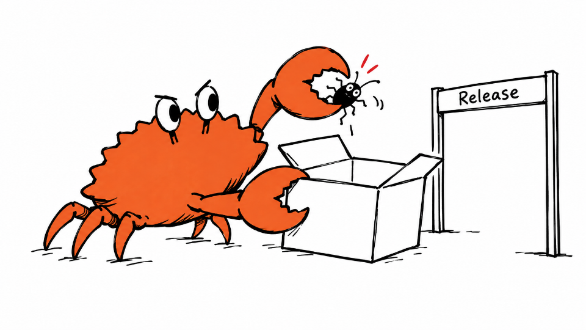
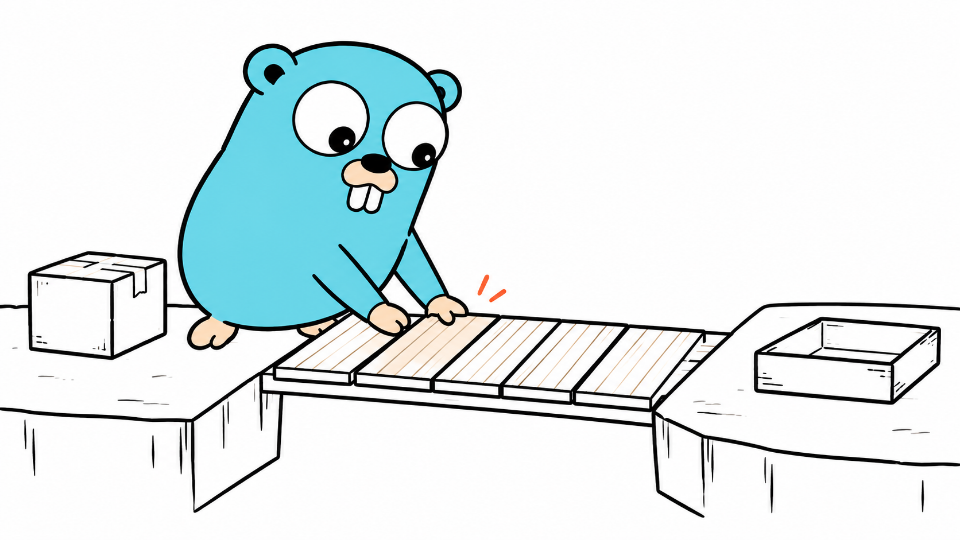

<p align="center">
  
</p>

# InkExplain

*Ідеї, які можна побачити.*

За допомогою ШІ перетворюйте складні ідеї на гарні ілюстрації в єдиному стилі, наче намальовані від руки.

<!-- inkexplain:languages:start -->
<details>
<summary>Languages</summary>

[English](../README.md) · [Español](./README.es.md) · [Português](./README.pt.md) · [Deutsch](./README.de.md) · [Français](./README.fr.md) · [简体中文](./README.zh.md) · [繁體中文](./README.zh-Hant.md) · [한국어](./README.ko.md) · [日本語](./README.ja.md) · [العربية](./README.ar.md) · [Русский](./README.ru.md) · [Türkçe](./README.tr.md) · **Українська**

</details>
<!-- inkexplain:languages:end -->

InkExplain — це навичка (skill) візуального мислення для ШІ-агентів. Дайте їй статтю, документ або лише одну ідею: вона виокремить ідеї, які варто намалювати, перетворить кожну на фізичну дію, яку виконує персонаж, і напише промпти, завдяки яким уся серія буде витримана в єдиному стилі. Якщо ваш агент має інструмент для генерування зображень, InkExplain також згенерує зображення, перевірить і збереже їх.

## Можливості

- **Планує** список кадрів: де розмістити кожне зображення, яку ідею воно передає і яка фізична метафора її показує.
- **Режисує героя**: на кожному зображенні ідею розігрує один персонаж, рука чи механізм, схоплений у вирішальний момент дії.
- **Пише промпти**, що об’єднують серію в одне ціле: один архетип, один стиль, свіжа метафора для кожного зображення.
- **Генерує й перевіряє** зображення за допомогою інструмента генерування, який має ваш агент, а потім зберігає їх під передбачуваними назвами.
- **Доопрацьовує** ілюстрації: прибирає зайві заголовки, виправляє підписи, спрощує перевантажені сцени, відновлює вигляд персонажа.

InkExplain підходить для технічних статей, пояснень продуктів і архітектури, робочих процесів, порівнянь, причинно-наслідкових зв’язків, навчальних матеріалів і лонгрідів, яким потрібна єдина візуальна мова.

## Як це працює

1. **Вибір архетипу**: персонаж, його манера руху та візуальний стиль. Якщо ви нічого не вказали, InkExplain використовує власний фірмовий стиль — InkExplain Sketch.
2. **Виокремлення концепції**: головна теза й когнітивні якорі — точки збою, моменти передавання роботи, компроміси, цикли, зміни «до і після».
3. **Планування**: одне зображення на ідею, і для кожного — тип структури, місце в композиційній сітці та побутова метафора, яку розігрує герой.
4. **Складання промпту**: агент складає промпт із шаблону архетипу у фіксованому порядку й генерує по одному зображенню за кожен виклик інструмента.
5. **Перевірка**: кожне зображення звіряють зі спільним чек-листом QA та власними критеріями архетипу, а потім за потреби виправляють або генерують повторно.
6. **Збереження та звіт**: зображення зберігаються в `assets/<article-slug>-…/` у вашій робочій області, а агент звітує про результат.

Планування й генерування навмисно розділено. InkExplain не має власної моделі для зображень і використовує інструмент генерування, який надає ваш агент. Якщо такого інструмента немає, InkExplain перемикається в **режим промптів** і видає вам повні промпти, готові до запуску. Навичка ніколи не стверджує, що згенерувала зображення, якого насправді не створювала.

## Встановлення

```bash
npx skills add agustinpabon/InkExplain --skill inkexplain
```

Для цього використовується відкритий [skills CLI](https://skills.sh) (потрібен Node.js 22.20 або новіший). Він визначає вашого агента, наприклад Claude Code, Codex, Cursor, Gemini CLI, GitHub Copilot, OpenCode або Windsurf, і копіює навичку в папку, яку цей агент читає. Додайте `-g`, щоб встановити її для всіх ваших проєктів, або `-a <agent>`, щоб вибрати агента. За замовчуванням CLI надсилає анонімну телеметрію використання; задайте `DISABLE_TELEMETRY=1`, щоб вимкнути її. Сам InkExplain нічого не збирає.

Без Node.js скопіюйте папку `skills/inkexplain/` у папку навичок вашого агента самостійно; список папок наведено в розділі «Підтримувані середовища».

## Використання

У Codex викликайте навичку як `$inkexplain`. У Claude Code та інших середовищах згадайте InkExplain у запиті або просто опишіть завдання: агент завантажить навичку, якщо запит відповідає її опису.

```text
$inkexplain Сплануй ілюстрації до цієї статті. Поки що нічого не генеруй.

<вставте статтю>
```

```text
$inkexplain Проілюструй цей допис чотирма зображеннями та збережи їх у проєкті.
```

```text
$inkexplain Використай Ferris. Одне зображення на тему: «володіння — це лише один власник у кожен момент часу».
```

```text
$inkexplain Режим промптів: напиши для трьох зображень промпти, які я вставлю у свій генератор зображень.
```

Більше прикладів, зокрема для кожного архетипу та для змішаних запитів, — у [examples/prompts.md](../examples/prompts.md).

## Архетипи

Архетип визначає, хто розігрує ідею, як він рухається і як намальовано сцену. Типовий архетип — InkExplain Sketch; будь-який інший обирають за назвою. Архетипи ніколи не змішуються в одному зображенні.

<!-- inkexplain:archetypes:start -->
<table>
<tr>
<td width="50%" valign="top"><a href="../assets/examples/ink.png"></a><br><b>InkExplain Sketch</b> · за замовчуванням<br>Bottlenecks · <a href="../assets/examples/ink.png">full size</a><br><sub>MIT · InkExplain contributors</sub></td>
<td width="50%" valign="top"><a href="../assets/examples/littlebox.png"></a><br><b>Littlebox</b><br>Caching · <a href="../assets/examples/littlebox.png">full size</a><br><sub>MIT · okooo5km</sub></td>
</tr>
<tr>
<td width="50%" valign="top"><a href="../assets/examples/stickman.png"></a><br><b>Stickman</b> · <code>experimental</code><br>Iteration · <a href="../assets/examples/stickman.png">full size</a><br><sub>MIT · InkExplain contributors</sub></td>
<td width="50%" valign="top"><a href="../assets/examples/xiaohei.png"></a><br><b>Xiaohei</b><br>Information overload · <a href="../assets/examples/xiaohei.png">full size</a><br><sub>MIT · Ian</sub></td>
</tr>
<tr>
<td width="50%" valign="top"><a href="../assets/examples/ferris.png"></a><br><b>Ferris</b><br>Bug prevention · <a href="../assets/examples/ferris.png">full size</a><br><sub>CC0 public-domain dedication · Karen Rustad Tölva</sub></td>
<td width="50%" valign="top"><a href="../assets/examples/gopher.png"></a><br><b>Go Gopher</b><br>Connecting services · <a href="../assets/examples/gopher.png">full size</a><br><sub>CC BY 4.0 (the design); CC BY 3.0 (the bundled reference drawing) · Renee French (design); Takuya Ueda (bundled drawing)</sub></td>
</tr>
<tr>
<td width="50%" valign="top"><a href="../assets/examples/tux.png"></a><br><b>Tux</b><br>Collaboration · <a href="../assets/examples/tux.png">full size</a><br><sub>Free to use and modify with credit to Larry Ewing and The GIMP · Larry Ewing</sub></td>
<td width="50%" valign="top"><a href="../assets/examples/openclaw.png"></a><br><b>OpenClaw</b><br>Automation · <a href="../assets/examples/openclaw.png">full size</a><br><sub>MIT · OpenClaw Foundation</sub></td>
</tr>
</table>
<!-- inkexplain:archetypes:end -->

- **Категорії**: `house-style` — власний стиль InkExplain; `mascot` — талісман проєкту чи спільноти, який використовують із зазначенням авторства; `tribute-character` — персонаж, створений третьою стороною, якого зображують у межах його правових рамок; `animation-preset` зарезервовано для оригінальних пресетів руху та постановки.
- **Статуси**: архетипи зі статусом `active` готові до використання; архетипи `experimental` обирають лише за назвою й позначають у кожному результаті; архетипи `gated-authorized` використовують лише тоді, коли їх назвали явно, лише в межах наявних у вас прав і ніколи не публікують без задокументованого дозволу.

Альтернативні назви, ДНК руху, стильові аркуші, зазначення авторства та обмеження для кожного архетипу наведено в [routing.md](../skills/inkexplain/references/routing.md); цей файл генерується з реєстру архетипів [registry.json](../skills/inkexplain/registry.json).

## Галерея прикладів

Приклади зображень Xiaohei без змін. Приклади решти персонажів буде опубліковано після перевірки.

| Одна риба — багато застосувань | Сортування за призначенням | Прес ідей |
|---|---|---|
|  |  |  |

<!-- inkexplain:gallery-credits:start -->
Xiaohei — персонаж Ian з Ian Xiaohei Illustrations (MIT). Зображення з англійськими підписами — копії зображень, опублікованих у Visual IP Illustrations (MIT), з китайськими — копії власних зображень Ian; усі без змін лежать у [examples/gallery](../examples/gallery) ([звідки взято кожне](../docs/provenance.md)). Приклади решти персонажів приховано до перевірки.
<!-- inkexplain:gallery-credits:end -->

## Додавання нових персонажів і стилів анімації

Архетипи — це дані та Markdown. Щоб додати новий, не потрібно писати код валідатора.

1. **Зареєструйте архетип.** Додайте запис до `archetypes` у [`skills/inkexplain/registry.json`](../skills/inkexplain/registry.json): id, назву, категорію, статус, короткий опис, альтернативні назви, суфікс виводу, `motionDna`, `styleSheet`, `legalNotice`, `sampleGates`, а також маркери ідентичності й ізоляції в `contract`. Для сторонніх персонажів потрібні правовласник, ліцензія та умови зазначення авторства; захищені персонажі починають зі статусу `gated-authorized`.
2. **Напишіть пакет.** Створіть `skills/inkexplain/references/archetypes/<id>/` із п’ятьма файлами пакета: `rights.md`, `identity.md`, `style.md`, `motion-and-acting.md` і `prompts.md`. Скопіюйте структуру наявного пакета; спільна методика в `references/workflow/` уже охоплює все інше.
3. **Згенеруйте та перевірте.** Додайте зазначення авторства до [ATTRIBUTIONS.md](../ATTRIBUTIONS.md) і приклад до [examples/prompts.md](../examples/prompts.md), а потім виконайте `npm run build:docs` і `npm run check`. Таблиця архетипів вище, `routing.md` і всі переклади оновляться самі.

Повний покроковий посібник із готовим записом реєстру та питаннями щодо прав, на які слід відповісти насамперед, — у [docs/adding-an-archetype.md](../docs/adding-an-archetype.md).

## Правила збереження результатів

- Кожен архетип зберігає файли в окремій теці вашої робочої області: `assets/<article-slug>-illustrations/` для типового архетипу та `assets/<article-slug>-<id>/` для решти.
- Імена файлів — пронумеровані англійські слаги: `01-two-breakpoints.png`, `02-handoff-path.png`.
- Наявні файли ніколи не перезаписуються: нові версії отримують наступний номер або суфікс `-v2`.
- У режимі промптів усередині проєкту промпти зберігаються у файлі `prompts.md` у тій самій теці.
- Результати завжди супроводжує короткий звіт: архетип, зображення та їхнє призначення, шляхи, найвдаліші й необов’язкові зображення, відкриті питання, а для сторонніх архетипів — примітка щодо прав.

## Підтримувані середовища

| Агент | Папка навички в проєкті |
|---|---|
| Claude Code | `.claude/skills/inkexplain` |
| Codex | `.agents/skills/inkexplain` |
| Cursor | `.agents/skills/inkexplain`; Cursor також читає `.claude/skills/` і `.codex/skills/` |
| Gemini CLI, GitHub Copilot, OpenCode | `.agents/skills/inkexplain` |
| Windsurf | `.windsurf/skills/inkexplain` |
| Інші агенти, що читають пакети `SKILL.md` | їхня папка навичок |

З прапорцем `-g` CLI встановлює навичку в особисту папку агента (наприклад, `~/.claude/skills/` для Claude Code і `~/.agents/skills/` для Codex).

Що перевірено: skills CLI правильно розміщує навичку для кожного агента з таблиці, а Claude Code показує її у списку. Нові сесії агентів Claude Code, яким вказали встановлену навичку, правильно дотримувалися її у 15 запитах, без інструмента для зображень, у режимі промптів ([оцінка](../docs/evaluation.md)). Не перевірено: чи підхоплює середовище навичку за простим запитом, запуск навички всередині Codex, Cursor, Gemini CLI, GitHub Copilot, OpenCode або Windsurf і генерацію зображень будь-яким інструментом.

## Налаштування

- **У кожному запиті**: звичайними словами вкажіть архетип, кількість зображень, співвідношення сторін, мову підписів або слаг статті.
- **Фірмовий стиль**: InkExplain Sketch міститься в `skills/inkexplain/references/archetypes/ink/`. Змінюйте `style.md` і `prompts.md` разом і синхронно оновлюйте палітру в `registry.json`.
- **Нові архетипи**: див. [Додавання нових персонажів і стилів анімації](../docs/adding-an-archetype.md).

## Вимоги

- Агент, який підтримує пакети навичок `SKILL.md`.
- Для генерування зображень: доступний цьому агентові інструмент генерування зображень.
- Для розробки: Node.js 22 або новіша версія. Встановлювати залежності не потрібно.

## Обмеження

- InkExplain не містить власної моделі генерування зображень; якість зображень залежить від інструмента, яким користується ваш агент.
- Моделі генерування зображень помиляються в написанні підписів; найважче їм дається нелатинське письмо. Робіть підписи короткими та перевіряйте їх.
- Для InkExplain Sketch поки що немає перевірених прикладів зображень.
- На сторонні архетипи поширюються обмеження їхніх власників. Архетипи з обмеженим доступом призначені для використання в межах наявних у вас прав, і InkExplain не публікує для них прикладів.
- Переклади README виконано за допомогою ШІ, і їх не перевіряли професійні перекладачі. Згенеровані таблиці містять дані реєстру англійською мовою.

## Розробка

```bash
npm test               # модульні тести, тести перевірок, CLI та репозиторію (вбудований засіб запуску тестів Node)
npm run validate       # перевірка репозиторію та пакета навички
npm run build:docs     # повторне генерування routing.md, таблиць архетипів і перемикачів мов у README
npm run check          # усе, що запускає CI
```

Архітектуру, модель поступового розкриття інформації (progressive disclosure), каталог перевірок і процес випуску описано в [docs/architecture.md](../docs/architecture.md) та [docs/release-checklist.md](../docs/release-checklist.md). Настанови для учасників проєкту й агентів — в [AGENTS.md](../AGENTS.md).

## Авторство та ліцензія

<!-- inkexplain:credits:start -->
InkExplain спирається на три попередні проєкти з ліцензією MIT: [Visual IP Illustrations](https://github.com/yangchuansheng/visual-ip-illustrations) автора yangchuansheng, [Ian Xiaohei Illustrations](https://github.com/helloianneo/ian-xiaohei-illustrations) автора Ian та [5km Littlebox Illustrations](https://github.com/okooo5km/5km-littlebox-illustrations) автора okooo5km. Зображення в галереї — незмінені копії з перших двох проєктів. Сторонні персонажі та торгові марки залишаються власністю їхніх власників. Джерела, повідомлення щодо кожного персонажа та ліцензії див. у [ATTRIBUTIONS.md](../ATTRIBUTIONS.md).
<!-- inkexplain:credits:end -->

InkExplain поширюється на умовах [ліцензії MIT](../LICENSE).
