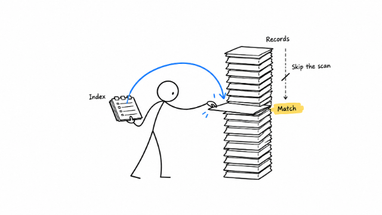
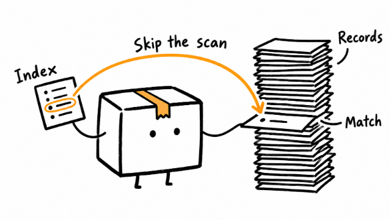
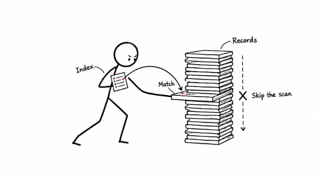
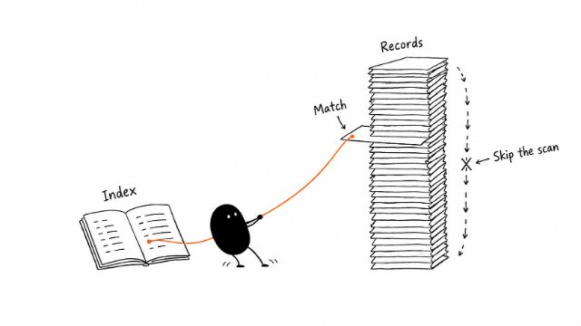
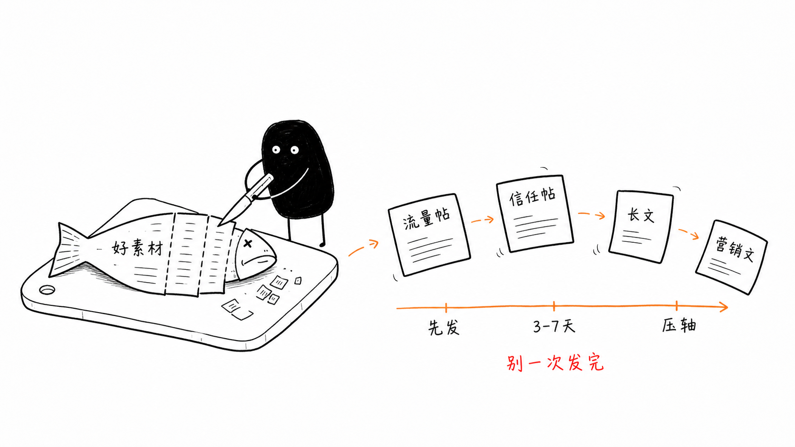
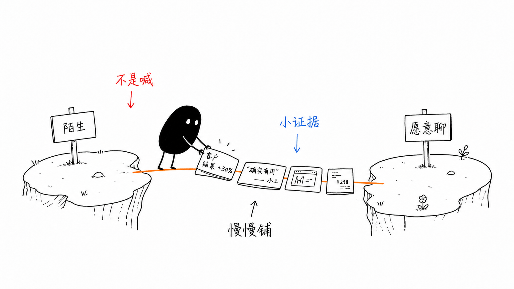
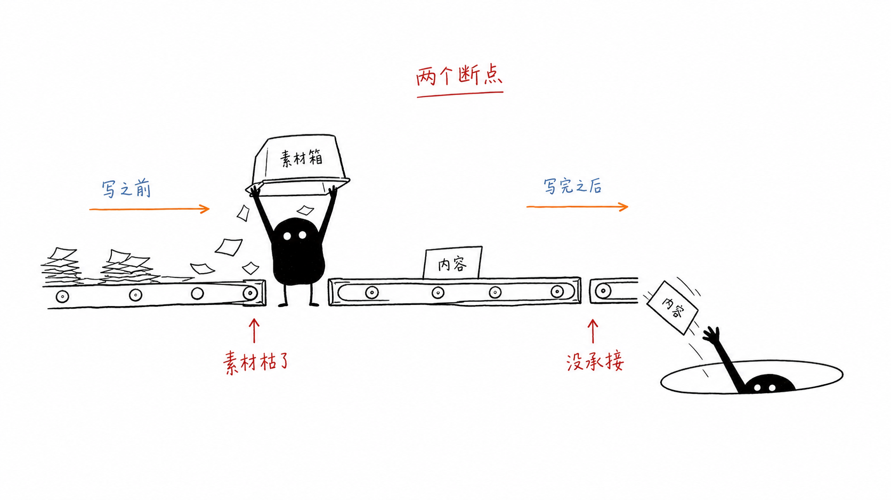

<p align="center">
  
</p>

# InkExplain

*讓想法看得見。*

運用 AI，把複雜的想法化為美觀、風格一致的手繪插圖。

<!-- inkexplain:languages:start -->
<details>
<summary>Languages</summary>

[English](../README.md) · [Español](./README.es.md) · [Português](./README.pt.md) · [Deutsch](./README.de.md) · [Français](./README.fr.md) · [简体中文](./README.zh.md) · **繁體中文** · [한국어](./README.ko.md) · [日本語](./README.ja.md) · [العربية](./README.ar.md) · [Русский](./README.ru.md) · [Türkçe](./README.tr.md) · [Українська](./README.uk.md)

</details>
<!-- inkexplain:languages:end -->

InkExplain 是一個供 AI 代理程式使用的視覺推理技能（skill）。交給它一篇文章、一份文件，或只是一個想法：它會萃取出值得畫成圖的想法，把每個想法轉化為由角色完成的一個具體動作，並撰寫讓整個系列維持一致的提示詞。如果你的代理程式具備圖像生成工具，它還會生成、檢查並儲存這些圖片。

## 能做什麼

- **規劃**配圖清單：每張圖放在哪裡、承載哪個想法，以及用哪個實物隱喻來呈現。
- **指導演出**：每張圖都由一個角色、一隻手或一台機器來演繹想法，並定格在最關鍵的那一刻。
- **撰寫提示詞**，讓整個系列連貫一致：同一個原型、同一種風格，每張圖都換上新的隱喻。
- **生成並檢查**圖片：透過你的代理程式提供的圖像工具產生圖片，再以可預期的檔名儲存。
- **修復**插圖：移除多餘的標題、修正標籤、簡化擁擠的畫面、讓走樣的角色恢復原貌。

它適合技術文章、產品與架構說明、工作流程、比較、因果關係、課程教材，以及需要一致視覺語言的長篇文章。

## 運作方式

1. **選擇原型**：也就是一個角色、它的動作方式與它的視覺風格。若沒有特別指定，InkExplain 會使用自家風格 InkExplain Sketch。
2. **萃取概念**：找出核心論點與認知錨點，例如斷點、交接、取捨、循環與前後變化。
3. **規劃**：一個想法一張圖，每張圖各有一種結構類型、在構圖網格上的一個位置，以及一個由主角演出的日常隱喻。
4. **組合提示詞**：依固定順序，以該原型的範本組合提示詞，接著每次呼叫工具只生成一張圖。
5. **檢查**：依共用的 QA 檢查清單與該原型專屬的檢查項目審查每一張圖；不合格就修復或重新生成。
6. **儲存並回報**：存放到工作區中的 `assets/<article-slug>-…/`，並回報結果。

規劃與生成是刻意分開的。InkExplain 本身不含圖像模型，而是使用你的代理程式所提供的圖像生成工具。如果沒有這類工具，它會切換到**提示詞模式**（prompt mode），交給你完整、可直接使用的提示詞。它絕不會聲稱生成了其實沒有生成的圖片。

## 安裝

```bash
npx skills add agustinpabon/InkExplain --skill inkexplain
```

這會使用開放的 [skills CLI](https://skills.sh)（需要 Node.js 22.20 或更新版本）。它會偵測你的智慧代理，例如 Claude Code、Codex、Cursor、Gemini CLI、GitHub Copilot、OpenCode 或 Windsurf，並把這個 skill 複製到該代理讀取的資料夾。加上 `-g` 可為你的所有專案安裝，加上 `-a <agent>` 可指定代理。預設情況下，該 CLI 會傳送匿名使用遙測；設定 `DISABLE_TELEMETRY=1` 即可關閉。InkExplain 本身不蒐集任何資料。

沒有 Node.js 時，請自行把資料夾 `skills/inkexplain/` 複製到你的代理的 skills 資料夾；「支援的環境」一節列出了這些資料夾。

## 使用方式

在 Codex 中，以 `$inkexplain` 呼叫此技能。在 Claude Code 與其他宿主環境中，可以直接指名 InkExplain，也可以只描述要做的事；當請求符合技能的描述時，代理程式就會載入它。

```text
$inkexplain 幫這篇文章規劃插圖，先不要生成。

<貼上文章>
```

```text
$inkexplain 為這篇貼文畫四張插圖，並儲存到專案中。
```

```text
$inkexplain 使用 Ferris。畫一張圖：「所有權代表同一時間有且只有一個擁有者。」
```

```text
$inkexplain 提示詞模式：幫三張圖寫好提示詞，讓我貼到自己的圖像工具中使用。
```

更多範例（包含每一個原型，以及混用多個原型的請求）請見 [examples/prompts.md](../examples/prompts.md)。

## 原型

原型決定由誰來演繹想法、它如何動作，以及畫面如何繪製。InkExplain Sketch 是預設原型；其他原型都必須指名才會使用。同一張圖中絕不會混用不同原型。

<!-- inkexplain:archetypes:start -->
<table>
<tr>
<td width="25%" valign="top"><br><b>InkExplain Sketch</b> · 預設<br>Black ink line, one blue flow, one yellow swipe.<br><sub>MIT · InkExplain contributors</sub></td>
<td width="25%" valign="top"><br><b>Littlebox</b><br>A closed paper box on a pure white page.<br><sub>MIT · okooo5km</sub></td>
<td width="25%" valign="top"><br><b>Stickman</b> · <code>experimental</code><br>One bold marker figure that acts out the idea.<br><sub>MIT · InkExplain contributors</sub></td>
<td width="25%" valign="top"><br><b>Xiaohei</b><br>A small black creature doing serious, absurd work.<br><sub>MIT · Ian</sub></td>
</tr>
<tr>
<td width="25%" valign="top"><b>Ferris</b><br>The Rust community crab.<br><sub>CC0 public-domain dedication · Karen Rustad Tölva</sub></td>
<td width="25%" valign="top"><b>Go Gopher</b><br>The Go gopher in sparse sketches.<br><sub>CC BY 4.0 (the design); CC BY 3.0 (the bundled reference drawing) · Renee French (design); Takuya Ueda (bundled drawing)</sub></td>
<td width="25%" valign="top"><b>Tux</b><br>Tux, the Linux penguin.<br><sub>Free to use and modify with credit to Larry Ewing and The GIMP · Larry Ewing</sub></td>
<td width="25%" valign="top"><b>OpenClaw</b><br>The red OpenClaw mascot with claw arms.<br><sub>MIT · OpenClaw Foundation</sub></td>
</tr>
</table>
<!-- inkexplain:archetypes:end -->

- **類別**：`house-style` 是 InkExplain 的原創風格；`mascot` 是標示出處後使用的專案或社群吉祥物；`tribute-character` 是由第三方創作、在其權利界線內繪製的角色；`animation-preset` 保留給原創的動作與場面調度預設。
- **狀態**：`active` 原型可以直接使用；`experimental` 原型只能指名選用，且每次交付都會特別標示；`gated-authorized` 原型只在指名時使用，且僅限於你自身取得的授權範圍內；沒有留下紀錄的授權，絕不公開發布。

每個原型的別名、動作 DNA、風格表、署名與限制請見 [routing.md](../skills/inkexplain/references/routing.md)，該檔案由原型定義檔 [registry.json](../skills/inkexplain/registry.json) 自動產生。

## 範例圖集

以下是小黑（Xiaohei）的範例圖，未作任何修改。其他角色的範例圖會在審查後再發布。

| 一魚多吃 | 信任橋 | 兩個斷點 |
|---|---|---|
|  |  |  |

<!-- inkexplain:gallery-credits:start -->
小黑（Xiaohei）是 Ian 在 Ian Xiaohei Illustrations 中創作的角色（MIT）。英文標籤的範例圖是 Visual IP Illustrations（MIT）所發布圖片的副本，中文標籤的範例圖是 Ian 自己圖片的副本，均未作修改，存放在 [examples/gallery](../examples/gallery)（[各圖的來源](../docs/provenance.md)）。其他角色的範例圖在審查完成前暫不發布。
<!-- inkexplain:gallery-credits:end -->

## 新增角色與動畫風格

原型就是資料加上 Markdown。新增一個原型不需要撰寫任何驗證器程式碼。

1. **登記原型。** 在 [`skills/inkexplain/registry.json`](../skills/inkexplain/registry.json) 的 `archetypes` 中加入一筆項目：id、名稱、類別、狀態、概要、別名、輸出後綴、`motionDna`、`styleSheet`、`legalNotice`、`sampleGates`，以及 `contract` 中的身分標記與隔離標記。第三方角色須註明其權利人、授權條款與署名條件；受保護的角色一律從 `gated-authorized` 開始。
2. **撰寫原型包。** 建立 `skills/inkexplain/references/archetypes/<id>/`，放入五個原型包檔案：`rights.md`、`identity.md`、`style.md`、`motion-and-acting.md` 與 `prompts.md`。沿用現有原型包的結構即可；其餘部分都已由 `references/workflow/` 中的共用方法涵蓋。
3. **產生並驗證。** 在 [ATTRIBUTIONS.md](../ATTRIBUTIONS.md) 加入署名，在 [examples/prompts.md](../examples/prompts.md) 加入一個範例，然後執行 `npm run build:docs` 與 `npm run check`。上方的原型表、`routing.md` 以及所有譯本都會自動更新。

完整的操作說明（附有一筆完整的定義檔項目，以及必須先釐清的權利問題）請見 [docs/adding-an-archetype.md](../docs/adding-an-archetype.md)。

## 輸出慣例

- 每個原型都會寫入工作區中各自的資料夾：預設原型寫入 `assets/<article-slug>-illustrations/`，其他原型則寫入 `assets/<article-slug>-<id>/`。
- 檔名採用加上編號的英文 slug，例如 `01-two-breakpoints.png`、`02-handoff-path.png`。
- 絕不覆寫既有檔案；新版本會使用下一個編號，或加上 `-v2` 後綴。
- 在專案中使用提示詞模式時，提示詞會以 `prompts.md` 存放在同一個資料夾。
- 每次交付最後都會附上一份簡短報告：使用的原型、各張圖片及其用途、儲存路徑、最出色的圖片與可省略的圖片、尚待處理的問題，以及第三方原型的權利說明。

## 支援的環境

| 代理 | 專案中的 skill 資料夾 |
|---|---|
| Claude Code | `.claude/skills/inkexplain` |
| Codex | `.agents/skills/inkexplain` |
| Cursor | `.agents/skills/inkexplain`; Cursor 也會讀取 `.claude/skills/` 和 `.codex/skills/` |
| Gemini CLI, GitHub Copilot, OpenCode | `.agents/skills/inkexplain` |
| Windsurf | `.windsurf/skills/inkexplain` |
| 其他讀取 `SKILL.md` 套件的代理 | 它們的 skills 資料夾 |

使用 `-g` 時，CLI 會改為安裝到該代理的個人資料夾（例如 Claude Code 的 `~/.claude/skills/` 與 Codex 的 `~/.agents/skills/`）。

已測試：skills CLI 會為上面每個代理正確放置該 skill，Claude Code 會列出它。全新的 Claude Code 代理工作階段在被指向已安裝的 skill 後，對 15 個請求都正確地遵循了它（沒有圖像工具，使用提示詞模式；見[評估](../docs/evaluation.md)）。未測試：宿主是否會根據一句普通請求自行載入該 skill，在 Codex、Cursor、Gemini CLI、GitHub Copilot、OpenCode 或 Windsurf 中執行該 skill，以及使用任何圖像工具生成圖像。

## 自訂

- **依請求指定**：在請求中用平常的說法指定原型、圖片數量、長寬比、標籤語言或文章 slug 即可。
- **自家風格**：InkExplain Sketch 位於 `skills/inkexplain/references/archetypes/ink/`。修改時請同步更新 `style.md` 與 `prompts.md`，並讓 `registry.json` 中的調色盤與之保持一致。
- **新增原型**：請見[新增角色與動畫風格](../docs/adding-an-archetype.md)。

## 環境需求

- 支援 `SKILL.md` 技能套件的代理程式。
- 若要生成圖片：該代理程式可使用的圖像生成工具。
- 若要參與開發：Node.js 22 以上版本。不需要安裝任何相依套件。

## 限制

- InkExplain 不附帶圖像模型；圖片品質取決於你的代理程式所使用的工具。
- 圖像模型常把標籤文字寫錯，非拉丁文字更是如此。請讓標籤盡量簡短，並仔細檢查。
- InkExplain Sketch 目前還沒有經過審查的範例圖。
- 第三方原型須遵守其擁有者所設的限制。受限原型僅能在你自身的授權範圍內使用，InkExplain 也不會為這些原型發布範例圖。
- 本 README 的各語言譯本是在 AI 協助下完成，尚未經過專業譯者審校。自動產生的表格中，來自定義檔的資料維持英文原樣。

## 開發

```bash
npm test               # 單元、檢查項目、CLI 與儲存庫測試（使用 Node 內建的測試執行器）
npm run validate       # 驗證儲存庫與技能套件
npm run build:docs     # 重新產生 routing.md、README 中的原型表與語言選單
npm run check          # 執行 CI 會跑的所有檢查
```

架構、漸進式揭露模型、檢查項目清單與發布流程的說明請見 [docs/architecture.md](../docs/architecture.md) 與 [docs/release-checklist.md](../docs/release-checklist.md)。給貢獻者與代理程式的指引請見 [AGENTS.md](../AGENTS.md)。

## 致謝與授權

<!-- inkexplain:credits:start -->
InkExplain 建立在三個先前採用 MIT 授權的專案之上：yangchuansheng 的 [Visual IP Illustrations](https://github.com/yangchuansheng/visual-ip-illustrations)、Ian 的 [Ian Xiaohei Illustrations](https://github.com/helloianneo/ian-xiaohei-illustrations) 與 okooo5km 的 [5km Littlebox Illustrations](https://github.com/okooo5km/5km-littlebox-illustrations)。圖庫中的圖片是前兩個專案圖片的未修改副本。第三方角色與商標歸其各自所有者所有。有關專案來源、各角色的詳細授權與說明，請參閱 [ATTRIBUTIONS.md](../ATTRIBUTIONS.md)。
<!-- inkexplain:credits:end -->

InkExplain 以 [MIT 授權條款](../LICENSE) 釋出。
